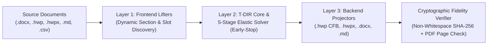

# T-DIR (`document-IR`) — Topological Document Intermediate Representation MCP Server

🌐 **[English (./README.md)](./README.md)** | 🇰🇷 **[한국어 (./README_KO.md)](./README_KO.md)**

> [!WARNING]
> **Work in Progress (Experimental Beta — `v3.0.0-beta`)**
> This repository is currently under active development and architectural verification. **It is NOT yet feature-complete or production-hardened.**
> - Several format lifters and projectors (such as direct `<hp:pic>` binary stream embedding inside standalone `.hwpx` packages, full `.xlsx` spreadsheet cell-style lifting, and multi-engine equation AST conversion) are still incomplete.
> - Internal data structures (`SectionIR`, `SlotSpecIR`, `TargetDocumentSpecIR`, `ElasticLayoutState`) and MCP tool parameters may undergo breaking changes as beta regression testing progresses.

---

## 1. Overview & Motivation

**T-DIR (Topological Document Intermediate Representation)** is a Model Context Protocol (MCP) server and document transformation engine designed to bridge structural and layout incompatibilities across Korean government/enterprise document formats (**HWP v5.0 Binary `.hwp`**, **OWPML `.hwpx`**) and global document formats (**OOXML `.docx`**, **Markdown `.md`**, **CSV/TSV `.csv`/`.tsv`**).

### Why Traditional 1:1 Document Converters Fail
1. **Box-Model & Coordinate Unit Discrepancies**: Direct translation between `HWPUNIT` ($1\text{ pt} = 100\text{ HU}$), `Twips` ($1\text{ pt} = 20\text{ dxa}$), and CSS pixels fails when nested tables have asymmetric cell margins, merged spans (`gridSpan` / `vMerge`), or empty decorative spacer columns.
2. **Line-Grid Snap Inflation (`snapToGrid`)**: Fonts with large vertical metrics (such as `Malgun Gothic` / `맑은 고딕`) trigger line-grid snapping in MS Word (`w:lineRule="auto"`), inflating 12pt body text to $\sim 22.2\text{ pt}$ per line and causing content to overflow fixed-page form templates.
3. **Rigid Form Template Boundaries**: Official Korean business plan and grant templates (`.hwp`) wrap each section inside fixed `2x2` outer layout tables and place media attachments in bottom `6x2` grid slots (`붙임`). Naive copy-pasting breaks outer table borders, duplicates headers across pages, or truncates overflowing text.
4. **LLM Context & Token Overhead**: Feeding tens of thousands of lines of raw OOXML (`word/document`) or OWPML (`Contents/section0`) XML into an LLM wastes context window tokens and risks accidental text hallucination or omission.

---

## 2. Core Architecture (3-Layer Topological Pipeline)

T-DIR separates **content semantics**, **2D grid topology**, and **physical metric projection** into three strictly isolated layers:



### Layer 1: Dynamic Lifters & Template Slot Scanner
- **Zero Hardcoded Offsets**: Inspects compressed `Section0` binary records (`Tag 71`, `Tag 77`, `Tag 72`) at runtime to automatically discover `2x2` section body slots (`Q1`..`Q4`) and `6x2` media attachment slots (`ATTACH 1..6`).
- **2D Topological Grid Normalization**: Resolves horizontal and vertical cell spans, prunes empty decorative spacer rows and columns, normalizes column width ratios $\sum w_i = 1.0$ with narrow-column clamping for arrow glyphs (`▶`, `→`), and folds stair-step visual chart tables into clean chronological data grids.

### Layer 2: 5-Stage Minimum-Invasion Elastic Layout Solver (`MinimumInvasionElasticSolver`)
To fit dense source sections into strict page budgets (e.g., fitting a 3.5-page source section into a 2.0-page template slot) **without over-squishing paragraphs**, `MinimumInvasionElasticSolver` executes a progressive 5-stage loop and **stops immediately (`Early-Stop`)** as soon as the estimated height fits within the target page budget:
- **Stage 1 (Spacers Only)**: Removes empty spacer paragraphs and empty table rows/columns, and disables document line-grid snapping (`snapToGrid = False`).
- **Stage 2 (Spacing & Padding Only)**: Progressively tightens body line spacing (`160% -> 142% -> 132% -> 122%`), table line spacing (`130% -> 125% -> 118% -> 112%`), and vertical cell padding (`100 HU -> 35 HU`) while keeping **100% of original paragraph breaks intact**.
- **Stage 3 (Subheading Inline Early-Stop)**: Converts standalone short subheadings ($\le 40$ chars, not ending with a period) into bold inline lead-ins (`[Bold Subheading]  [Body Paragraph]`) using whitespace-only joining (`"  "`) so non-whitespace character hashes remain identical.
- **Stage 4 (Partial Cell Merge Early-Stop)**: Sorts multi-paragraph table cells by shortest combined character length and merges one adjacent pair at a time, checking the height budget after **every single merge** to preserve maximum table cell line breaks.
- **Stage 5 (Minimal Body Continuation Early-Stop)**: Only if still over budget after Stage 4, merges the shortest adjacent body continuation paragraphs one by one until the page budget is met.

### Layer 3: Deterministic Binary & XML Projectors + SHA-256 Verifier
- **Native HWP v5.0 Binary Projector ([`./codec_hwp_v5.py`](./codec_hwp_v5.py) + [`./cfb_ole2.py`](./cfb_ole2.py))**: Directly synthesizes HWP v5.0 binary records and repacks the MS-CFB (`CFBArchive` OLE2 Compound File Binary) container with valid 512-byte FAT sectors, 64-byte MiniFAT chains, and Red-Black tree directory links.
- **100.00% Text Immutability Guarantee ([`./ir_schema.py`](./ir_schema.py))**: Every conversion is cryptographically audited via `SHA-256` over normalized non-whitespace character sequences, verifying zero character loss across `.hwp`, `.hwpx`, `.docx`, and `.md` outputs.

---

## 3. Repository Structure

| Module Path | Description |
| :--- | :--- |
| [`./__init__.py`](./__init__.py) | Package initialization and exported classes (`TdirBetaMcpServer`, `MinimumInvasionElasticSolver`). |
| [`./ir_schema.py`](./ir_schema.py) | T-DIR v3.0 data structures (`TextRunIR`, `ParagraphIR`, `TableCellIR`, `TableGridIR`, `MediaObjectIR`, `SectionIR`, `SlotSpecIR`, `TargetDocumentSpecIR`, `ConversionJobIR`) and cryptographic non-whitespace `SHA-256` verifier. |
| [`./cfb_ole2.py`](./cfb_ole2.py) | Pure-Python MS-CFB (`CFBArchive` OLE2 Compound File Binary v3) reader and writer supporting 512B standard sectors, 64B mini-streams, and balanced Red-Black directory trees. |
| [`./elastic_solver.py`](./elastic_solver.py) | 2D table grid normalizer and `MinimumInvasionElasticSolver` 5-stage Early-Stop layout engine (`ElasticLayoutState`). |
| [`./codec_hwp_v5.py`](./codec_hwp_v5.py) | HWP v5.0 binary record parser, dynamic template slot scanner, lifter, and binary projector. |
| [`./codec_ooxml_owpml.py`](./codec_ooxml_owpml.py) | OOXML (`.docx`) and OWPML (`.hwpx`) dynamic section lifters and projectors. |
| [`./codec_tabular_markup.py`](./codec_tabular_markup.py) | Markdown (`.md`) and Tabular (`.csv`, `.tsv`) lifters and projectors. |
| [`./mcp_server.py`](./mcp_server.py) | Standalone JSON-RPC 2.0 stdio MCP server (`TdirBetaMcpServer` / `tdir-document-beta`) exposing 5 tools. |
| [`./test_regression_suite.py`](./test_regression_suite.py) | End-to-end regression suite verifying dynamic probing, Early-Stop solving, multi-format projection, `SHA-256` text immutability, and PDF page boundary counts. |

---

## 4. MCP Tools Specification

The server ([`./mcp_server.py`](./mcp_server.py)) communicates over standard JSON-RPC 2.0 (`stdio`) and exposes 5 tools:

```python
# 1. Probe source documents and target template slots dynamically
tdir_probe_files(source_paths: list[str], target_path: str) -> dict

# 2. Build section/media mapping plan and preview Elastic Solver Early-Stop stage
tdir_build_mapping_plan(job_id: str, user_constraints: dict | None = None) -> dict

# 3. Execute deterministic projection into ["hwp", "hwpx", "docx", "md"]
tdir_execute_conversion(job_id: str, output_prefix: str, output_formats: list[str], base_hwpx_path: str | None = None) -> dict

# 4. Verify 100.00% non-whitespace SHA-256 text immutability and rendered PDF page count
tdir_verify_fidelity_and_layout(job_id: str, export_pdf: bool = True) -> dict

# 5. Pinpoint adjustment of paragraph merge lock or table column widths
tdir_adjust_block_layout(job_id: str, section_uid: str, block_index: int, lock_unmerged: bool | None = None, col_widths_hu: list[int] | None = None) -> dict
```

1. **Tool 1 — Probe Source & Template Files**: Dynamically detects file formats, extracts source sections with non-whitespace character counts and `SHA-256` hashes, and scans the target template for available section and attachment slots without transferring raw XML/binary payloads to the LLM context.
2. **Tool 2 — Build Mapping Plan & Elastic Preview**: Maps discovered source sections and embedded media to target template slots and runs a dry-run simulation of `MinimumInvasionElasticSolver` to report which stage (`Stage 1`..`Stage 5`) each section stops at and how many paragraphs are preserved.
3. **Tool 3 — Execute Multi-Format Conversion**: Executes deterministic projection into the requested formats (`["hwp", "hwpx", "docx", "md"]`).
4. **Tool 4 — Verify Cryptographic Fidelity & Layout**: Re-parses generated `.hwp`, `.hwpx`, and `.docx` files to verify 100.00% non-whitespace character containment (`0` lost characters), and optionally exports a rendered PDF to verify exact page count compliance.
5. **Tool 5 — Pinpoint Block Layout Adjustment**: Allows fine-grained adjustment of individual blocks (such as locking a specific paragraph from being merged in Stage 3/5 or overriding table column widths) before re-projecting.

---

## 5. Quickstart & Usage

### Prerequisites
- Python 3.10+ (Zero external third-party pip dependencies required for core `.hwp`, `.hwpx`, `.docx`, `.md`, `.csv` lifting and projection; uses Python standard library modules `zlib`, `struct`, `zipfile`, `hashlib`).
- Optional: Microsoft Word (on Windows) if headless PDF page-count verification is enabled in Tool 4.

### Running as an MCP Server
Add `tdir-document-beta` to your MCP client configuration:

```json
{
  "mcpServers": {
    "tdir-document-beta": {
      "command": "python",
      "args": ["mcp_server.py"],
      "cwd": "/path/to/-document-IR"
    }
  }
}
```

---

## 6. Known Limitations & Development Roadmap (WIP)

Because this project is currently in **Early Beta (`v3.0.0-beta`)**, please note the following incomplete areas:
1. **Standalone `.hwpx` Binary Image Injection**: While `.hwp` (v5.0 Binary) and `.docx` fully embed binary image streams (`BinData/BIN0001` and `word/media/image1`) into `6x2` attachment cells, `.hwpx` projection currently outputs attachment captions and requires `<hp:pic>` + `BinData/` ZIP entry injection in a future update.
2. **Arbitrary Template Topology Generalization**: Dynamic slot discovery currently targets `2x2` section tables and `6x2` attachment tables used in standard Korean startup/R&D grant templates, and is being generalized to arbitrary $N \times M$ form templates.
3. **Math / Equation AST (`OMML` $\leftrightarrow$ `HWP EQN` $\leftrightarrow$ `LaTeX`)**: Equation nodes are currently preserved as text runs; full bidirectional equation AST compilation is planned for `v3.1`.
4. **Native `.xlsx` & `.html` Projectors**: `.csv`/`.tsv` and `.md` lifters/projectors are implemented; full styled `.xlsx` and `.html` DOM projectors are in progress.
