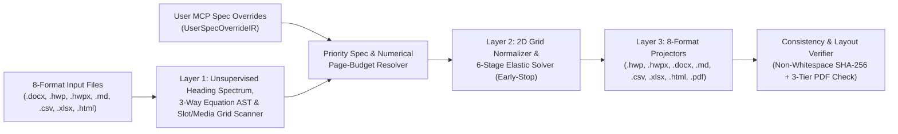

# SADT (Stella Actuation Document Transfer) — HWP · HWPX · DOCX Document MCP Server

**[last patch : 2026-11-16 07:43:00 UTC]**

🌐 **[English (./README.md)](./README.md)** | 🇰🇷 **[한국어 (./README_KO.md)](./README_KO.md)** | 🤖 **[Agent Summary (./llms.txt)](./llms.txt)** | 📋 **[MCP Manifest (./server.json)](./server.json)**

> [!NOTE]
> **Active Open-Source Release (`v4.1.0`) — Capabilities & Current Scope**
> SADT (powered by the **T-DIR** Topological Document Intermediate Representation engine) is under active development. All 8 target formats (`.hwp`, `.hwpx`, `.docx`, `.xlsx`, `.html`, `.pdf`, `.md`, `.csv`), standalone `.hwpx` packaging, 3-Way Equation AST conversion, defensive archive validation (`[SEC-01]` ~ `[SEC-06]`), and 14 parametric regression cohorts (`EXP-01` ~ `EXP-14`) pass in our test suite. However, highly customized legacy macros, encrypted DRM files, or complex free-form vector objects may still require manual review after conversion.

---

## 1. What SADT Does (In 30 Seconds)

**SADT (Stella Actuation Document Transfer)** is a **zero-dependency Python MCP server and multi-format document engine** built for Korean `.hwp` (v5.0 binary), `.hwpx` (OWPML), MS Word (`.docx`), Excel (`.xlsx`), HTML5 (`.html`), PDF 1.4 (`.pdf`), Markdown (`.md`), and CSV/TSV transformations without requiring Hancom Office or LibreOffice.

### Common Problems It Solves
- **"How do I parse or generate Korean `.hwp` / `.hwpx` files in Python without installing Hancom Office?"**  
  SADT includes a pure-Python MS-CFB OLE2 reader/writer ([`./cfb_ole2.py`](./cfb_ole2.py)) and HWP v5.0 / OWPML codecs ([`./codec_hwp_v5.py`](./codec_hwp_v5.py), [`./codec_ooxml_owpml.py`](./codec_ooxml_owpml.py)) using only the Python standard library.
- **"How can an AI agent fill an official HWP government or grant form without breaking outer tables or overflowing page limits?"**  
  Instead of dumping giant XML files into an LLM prompt, SADT scans template slots (`SLOT 01..M`) and `2R x C` media grids (`MEDIA 01..P`) dynamically, fits sections to page budgets using a 6-stage `MinimumInvasionElasticSolver`, and verifies text preservation with non-whitespace `SHA-256` hashing.
- **"How do I keep formulas and merged tables intact across Word, HWP, Markdown, Excel, and HTML?"**  
  SADT preserves nested/merged grid structures and translates equations across Word `OMML`, Hancom `HWP EQN`, and `LaTeX` through a unified Equation AST compiler ([`./ir_schema.py`](./ir_schema.py)).

---

## 2. Quickstart (`uvx`, `pip`, or Direct Execution)

**Repository URL**: [Team-Sequence-Thaumaturge/-document-IR](https://github.com/Team-Sequence-Thaumaturge/-document-IR) (see [`./llms.txt`](./llms.txt) or [`./server.json`](./server.json) for the remote `git+https` `uvx` manifest snippet).

### Option A — Run via `uvx` or `pip` (Zero External Dependencies)
Clone the repository linked above, then install or launch `sadt-mcp` directly via `uvx` or `pip`:

```bash
git clone <repository-url>
cd -document-IR

# Launch MCP stdio server directly with uvx
uvx --from . sadt-mcp

# Or install locally with pip and run the CLI entrypoint
pip install -e .
sadt-mcp

# Or run standalone with Python 3.10+
python mcp_server.py
```

Add `sadt-mcp` to Claude Desktop, Cursor, Windsurf, or Antigravity MCP settings:

```json
{
  "mcpServers": {
    "sadt-mcp": {
      "command": "uvx",
      "args": ["--from", "/path/to/-document-IR", "sadt-mcp"]
    }
  }
}
```

> [!TIP]
> You can also run without cloning by passing the `git+https` repository URL from [`./llms.txt`](./llms.txt) as the `--from` argument to `uvx` or `pip install`.

---

## 3. Comparison with Common Document Tools

| Feature | **SADT (`sadt-mcp`)** | `pyhwp` / `olefile` | `pandoc` | `python-docx` |
| :--- | :--- | :--- | :--- | :--- |
| **Pure-Python HWP v5.0 Read & Write** | Read + Write (`CFBArchive`) | Mainly Read / Extract | Not supported | Not supported |
| **Standalone `.hwpx` Synthesis** | Supported (`<hp:pic>`, `BinData`) | Not supported | Not supported | Not supported |
| **Multi-Format Coverage** | 8 formats (`.hwp`, `.hwpx`, `.docx`, `.xlsx`, `.html`, `.pdf`, `.md`, `.csv`) | HWP focus | Text / DOCX / HTML / LaTeX | `.docx` only |
| **3-Way Equation AST Translation** | `OMML` $\leftrightarrow$ `HWP EQN` $\leftrightarrow$ `LaTeX` | Limited | No HWP equation support | Raw XML / manual |
| **Template Slot & Page-Budget Fitting** | Unsupervised scanner + 6-stage solver | Not included | Not included | Not included |
| **Native MCP (`stdio`) Integration** | Built-in (`5` tools + JSON-RPC 2.0) | CLI / Python API only | CLI only | Python API only |
| **External Dependencies** | Zero (Python 3.10+ stdlib only) | External dependencies | Haskell binary | `lxml` |

---

## 4. Architecture Overview (Zero Hardcoded Document Rules)

SADT separates **content topology**, **specification priority resolution**, **equation AST compilation**, **numerical page-budget allocation**, and **format projection** so no font name, paper size, section title (`Q1..Q4`), or page count is hardcoded in the engine:



### 4.1. 3-Tier Specification Priority Resolution
Runtime formatting, font families, font sizes, margins, and paper sizes are resolved using the priority rule in [`./ir_schema.py`](./ir_schema.py):

$$\text{EffectiveSpec} = \text{Priority 1 }(\text{UserSpecOverrideIR}) \succ \text{Priority 2 }(\text{TargetDocumentSpecIR}) \succ \text{Priority 3 }(\text{SourceDocumentSpecIR})$$

1. **Priority 1 — `UserSpecOverrideIR`**: Explicit user or agent constraints passed through MCP calls (body/table font families and point sizes, line spacing min/max percentages, page dimensions and margins in millimeters, total page limit, per-section page budgets, outer table policy, and attachment captions).
2. **Priority 2 — `TargetDocumentSpecIR` ([`./codec_hwp_v5.py`](./codec_hwp_v5.py))**: Dynamically extracted from the target HWP template binary streams (`DocInfo` font/char/para records `Tag 19`, `Tag 21`, `Tag 25` and `Section0..SectionN` page definitions `Tag 73`, cover/preamble blocks, `NxM` container tables `SLOT 01..M`, and alternating `2R x C` media grids `MEDIA 01..P`).
3. **Priority 3 — `SourceDocumentSpecIR` ([`./codec_ooxml_owpml.py`](./codec_ooxml_owpml.py))**: Dynamically extracted from `.docx`, `.hwpx`, or `.hwp` source documents as fallback typography when template cells contain empty placeholders.

### 4.2. Unsupervised Section & Generalized Media Grid Topology
- **Unsupervised Top-Level Section Detector**: Estimates the statistical mode body font size $S_{\text{mode}}$ across paragraphs and identifies sections (`SEC 01..K`, `PREAMBLE`, `REFERENCES`) via outline levels, multilingual structural prefixes (`제1장`, `I.`, `Ⅰ.`, `Chapter 1`, `Q1.`), or bold typographic size jumps ($\ge S_{\text{mode}} + 150\text{ HU}$).
- **Universal Section Selector Matcher**: `UserSpecOverrideIR` accepts generic IDs (`SEC 01`), slot IDs (`SLOT 01`), ordinal indices (`1`, `"2"`), or title substrings without any hardcoded document-specific exclusions.
- **Generalized $2R \times C$ Media Grid Scanner**: Detects even-row grid tables ($R \ge 1, 1 \le C \le 4$) where image rows ($H_{2r} \ge 3000\text{ HU}$) alternate with compact caption rows ($H_{2r} \ge 2 \cdot H_{2r+1}$), registering `MEDIA 01..P` (`SlotSpecIR`).

### 4.3. Elastic Layout & Multi-Format Codecs
- **6-Stage `MinimumInvasionElasticSolver` ([`./elastic_solver.py`](./elastic_solver.py))**: Adjusts section content smoothly across progressive stages (**Stage 1** empty spacer cleanup $\to$ **Stage 2** line-spacing interpolation $\to$ **Stage 3** standalone subheading inline lead-in $\to$ **Stage 4** shortest table cell paragraph pair merge $\to$ **Stage 5** shortest body continuation merge $\to$ **Stage 6** optional `-0.5pt` font scaling) and stops immediately once the resolved page budget is met.
- **Standalone OWPML (`.hwpx`) Package Synthesis & Lifting**: Generates compliant `.hwpx` archives (`mimetype`, `META-INF/container`, `Contents/content`, `Contents/header`, `Contents/section0`) with injected `<hp:pic>` / `Contents/BinData/` media even without a base `.hwpx` file, and lifts existing `.hwpx` files back into `SectionIR`.
- **3-Way Equation AST Compiler**: Parses and compiles mathematical expressions across Word `OMML` (`<m:oMath>`), Hancom `HWP EQN` (`Tag 105` in `.hwp` and `<hp:equation>` in `.hwpx`), and `LaTeX` (`$...$` / `$$...$$` in Markdown and `<math data-latex="...">` in HTML).
- **Bidirectional `.xlsx` & `.html` + Pure-Python `.pdf`**: Supports shared strings, `<mergeCells>`, `rowspan`/`colspan`, base64 media, and built-in multi-page PDF 1.4 rendering with Type0/CIDFontType2 UTF-16BE (`<FEFF...>`) CJK strings paired with 3-tier PDF inspection (**Tier 1** MS Word COM $\to$ **Tier 2** LibreOffice $\to$ **Tier 3** Built-in PDF 1.4).

### 4.4. Defensive Security & State Isolation Checks (`[SEC-01]` ~ `[SEC-06]`)
- `[SEC-01]` Rejects XML `DOCTYPE` and `ENTITY` declarations (XXE defense) and enforces a `64 MB` XML input ceiling.
- `[SEC-02]` Blocks ZIP traversal (`../`, drive prefixes), limits archive entries (`4,096`) and decompressed sizes (`64 MB`/entry, `256 MB` total), and uses bounded streaming `zlib` decompression in `.hwp` streams (`64 MB` ceiling).
- `[SEC-03]` Checks MS-CFB headers, caps directory entries (`8,192`) and stream reads (`128 MB`), and tracks visited sectors across `DIFAT`, `FAT`, and `MiniFAT` chains (`CFBArchive`) to exit cyclic structures safely.
- `[SEC-04]` Validates local paths against null bytes and Windows reserved device filenames.
- `[SEC-05]` Strips illegal XML 1.0 control characters and prefixes leading spreadsheet formula symbols (`=`, `+`, `-`, `@`) with an apostrophe to mitigate DDE injection.
- `[SEC-06]` Deep-copies `SectionIR.blocks` before solving so repeated runs on the same job remain repeatable, bounded by a `64`-job LRU cache (`TdirBetaMcpServer`).

---

## 5. Repository Structure

| Module Path | Description |
| :--- | :--- |
| [`./pyproject.toml`](./pyproject.toml) | PEP 621 zero-dependency packaging metadata (`sadt-mcp`) with `sadt-mcp`, `sadt`, and `tdir-mcp` CLI entrypoints. |
| [`./server.json`](./server.json) | Official MCP Registry manifest describing server coordinates, `uvx` runtime hints, and exposed tools. |
| [`./smithery.yaml`](./smithery.yaml) | Smithery `stdio` MCP launch configuration. |
| [`./llms.txt`](./llms.txt) | Concise AI-crawler summary for Generative Engine Optimization (GEO). |
| [`./llms-full.txt`](./llms-full.txt) | Detailed LLM and agent guide covering schemas, override parameters, comparisons, and scope boundaries. |
| [`./__init__.py`](./__init__.py) | Package exports (`SadtMcpServer`, `TdirBetaMcpServer`, `MinimumInvasionElasticSolver`, `SourceDocumentSpecIR`, `TargetDocumentSpecIR`, `UserSpecOverrideIR`) at `v4.1.0`. |
| [`./ir_schema.py`](./ir_schema.py) | Canonical IR dataclasses, 3-Way Equation AST compiler, security validators (`[SEC-01]`..`[SEC-05]`), heading spectrum detector, and non-whitespace `SHA-256` checker. |
| [`./cfb_ole2.py`](./cfb_ole2.py) | Pure-Python MS-CFB (`CFBArchive` OLE2 Compound File Binary v3) reader/writer with cycle guards, `DIFAT` chain allocation, `BinData` synthesis, and Red-Black directory tree serialization. |
| [`./elastic_solver.py`](./elastic_solver.py) | 2D table topology normalizer, numerical page-budget allocator, and 6-stage `MinimumInvasionElasticSolver`. |
| [`./codec_hwp_v5.py`](./codec_hwp_v5.py) | HWP v5.0 binary record parser, `DocInfo` extractor, `Tag 105` equation codec, surrogate-pair safe `WCHAR` encoder, and generalized slot scanner/projector. |
| [`./codec_ooxml_owpml.py`](./codec_ooxml_owpml.py) | OOXML (`.docx`) and OWPML (`.hwpx`) lifters, scanners, equation handlers, and standalone `.docx` / `.hwpx` projectors. |
| [`./codec_tabular_markup.py`](./codec_tabular_markup.py) | Bidirectional Markdown, CSV/TSV, Excel (`.xlsx`), HTML5 (`.html`), and built-in PDF 1.4 projectors/inspectors. |
| [`./mcp_server.py`](./mcp_server.py) | Standalone JSON-RPC 2.0 `stdio` MCP server (`SadtMcpServer` / `TdirBetaMcpServer` `sadt-mcp` `v4.1.0`) supporting direct script launch (`python mcp_server.py`) and package imports. |
| [`./test_regression_suite.py`](./test_regression_suite.py) | **14-Cohort Parametric Regression Suite (`EXP-01` ~ `EXP-14`)** testing hierarchy detection, page budgets, metric scaling, table topology, round-trips, equations, security checks, and `uvx`/GEO packaging. |

---

## 6. MCP Tools & `UserSpecOverrideIR` Reference

The server ([`./mcp_server.py`](./mcp_server.py)) communicates over JSON-RPC 2.0 (`stdio`) and exposes 5 tools:

```python
# 1. Inspect source documents (.docx, .hwp, .hwpx, .md, .csv, .tsv, .xlsx, .html) & template
tdir_probe_files(source_paths: list[str], target_path: str) -> dict

# 2. Resolve specs, section-to-slot mapping, and page budgets
tdir_build_mapping_plan(
    job_id: str,
    user_spec_overrides: dict | None = None,
    user_constraints: dict | None = None,
) -> dict

# 3. Execute conversion into ["hwp", "hwpx", "docx", "md", "csv", "xlsx", "html", "pdf"]
tdir_execute_conversion(
    job_id: str,
    output_prefix: str,
    output_formats: list[str] | None = None,
    page_body_height_hu: int | None = None,
    base_hwpx_path: str | None = None,
    user_spec_overrides: dict | None = None,
) -> dict

# 4. Run non-whitespace SHA-256 text consistency check and 3-tier PDF page-budget check
tdir_verify_fidelity_and_layout(job_id: str, export_pdf: bool = True) -> dict

# 5. Fine-tune an individual paragraph merge lock or table column width array
tdir_adjust_block_layout(
    job_id: str,
    section_uid: str,
    block_index: int,
    lock_unmerged: bool | None = None,
    col_widths_hu: list[int] | None = None,
) -> dict
```

### Example `UserSpecOverrideIR` Payload
```json
{
  "body_font_family": "함초롬바탕",
  "table_font_family": "함초롬돋움",
  "body_font_size_pt": 11.5,
  "table_font_size_pt": 9.5,
  "body_line_spacing_min_pct": 122,
  "body_line_spacing_max_pct": 160,
  "page_width_mm": 210.0,
  "page_height_mm": 297.0,
  "margins_mm": {"top": 15.0, "bottom": 15.0, "left": 20.0, "right": 20.0},
  "total_page_limit": 8,
  "section_page_budgets": {"SEC_01": 2.0, "SEC_02": 2.0},
  "preserve_outer_tables": true,
  "route_media_to_attachment_slots": true,
  "max_attachment_images": 3,
  "allow_font_size_elastic_scaling": false,
  "style_inheritance_mode": "TARGET_FIRST"
}
```

---

## 7. 14-Cohort Regression Suite ([`./test_regression_suite.py`](./test_regression_suite.py))

| Cohort ID | Experiment Scope | Verified Result |
| :--- | :--- | :--- |
| **`EXP-01`** | Document hierarchy & unsupervised heading spectrum (`제1장..제3장`, `I..III`, bold size jumps, real proposal template) | `PASS` |
| **`EXP-02`** | Numerical page-budget sweep (`3p` $\to$ `0` merges, auto `8` pages $\to$ `11` merges, `1p` $\to$ `108` merges, asymmetric `4:1` split) | `PASS` |
| **`EXP-03`** | Continuous `HWPUNIT` scaling across `A4 Landscape` (`9pt`) and `B5 Portrait` (`13.5pt`) | `PASS` |
| **`EXP-04`** | 2D table topology collapse (stair-step `5x4` $\to$ `3x3`, arrow folding `3x1` $\to$ `2x1`, `<w:sdt>` unwrap) | `PASS` |
| **`EXP-05`** | Generalized `4x2` media grid discovery, automatic `BinData` creation, and slotless plain document mode | `PASS` |
| **`EXP-06`** | N-to-M cross-format round-trips (`.docx` $\to$ `.md` and `.docx` $\to$ `.csv`) | `PASS` |
| **`EXP-07`** | UTF-16LE surrogate-pair `WCHAR` accounting (`"A🚀B𝕏\r"`) and `7.2 MB` `DIFAT` sector chain round-trip | `PASS` |
| **`EXP-08`** | Multi-source heterogeneous merge (`[.docx, .csv, .md]`) + Tool 5 block layout adjustment loop | `PASS` |
| **`EXP-09`** | Standalone `.hwpx` synthesis (with binary `<hp:pic>` media injection) and `.hwpx` $\to$ `.hwp`/`.docx` round-trip | `PASS` |
| **`EXP-10`** | 3-Way Equation AST compilation across `OMML`, `HWP EQN` (`Tag 105` / `<hp:equation>`), and `LaTeX` | `PASS` |
| **`EXP-11`** | Bidirectional `.xlsx` (`106` rows, `<mergeCells>`) and `.html` (`rowspan`/`colspan`, base64 media) round-trips | `PASS` |
| **`EXP-12`** | Built-in multi-page PDF 1.4 rendering (`8` pages) and UTF-16BE (`<FEFF...>`) text extraction consistency check | `PASS` |
| **`EXP-13`** | Security checks (`[SEC-01]`..`[SEC-06]`): XXE rejection, `Zip-Slip` blocking, `MiniFAT` cycle guard, DDE escaping, idempotence | `PASS` |
| **`EXP-14`** | Standalone `python mcp_server.py` `stdio` initialize check (`sadt-mcp` `v4.1.0`), PEP 621 packaging metadata, and GEO manifests | `PASS` |

---

## 8. Frequently Asked Questions (FAQ)

- **Does SADT require Hancom Office or Microsoft Word to run?**  
  No. Core conversion across `.hwp`, `.hwpx`, `.docx`, `.xlsx`, `.html`, `.pdf`, `.md`, and `.csv` runs purely with Python 3.10+ standard libraries on Windows, macOS, and Linux. External Word COM or LibreOffice is optional and used only when Tier-1 or Tier-2 PDF layout verification is desired; Tier-3 built-in PDF verification runs everywhere.
- **Can I convert `.docx` or `.md` into `.hwp` without an `.hwpx` base file?**  
  Yes. You can either project into an existing `.hwp` form template (`SLOT 01..M`) or synthesize a standalone `.hwpx` archive directly with no reference `.hwpx` input.
- **How does SADT fit overflowing content into fixed-page templates?**  
  After normalizing tables, the 6-stage `MinimumInvasionElasticSolver` incrementally tightens line spacing within user bounds, converts short standalone subheadings into inline lead-ins, and merges only minimal continuation blocks until the per-section page budget is met—preserving all source text characters checked via `SHA-256`.
