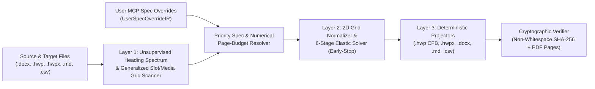

# T-DIR (`document-IR`) — Topological Document Intermediate Representation MCP Server

**[last patch : 2026-11-09 01:08:00 UTC]**

🌐 **[English (./README.md)](./README.md)** | 🇰🇷 **[한국어 (./README_KO.md)](./README_KO.md)**

> [!WARNING]
> **Work in Progress (Experimental Beta — `v3.2.0-beta`)**
> This repository is currently under active development and architectural verification. **It is NOT yet feature-complete or production-hardened.**
> - Several format lifters and projectors (such as direct `<hp:pic>` binary stream embedding inside standalone `.hwpx` packages, full `.xlsx` spreadsheet cell-style lifting, and multi-engine equation AST conversion) are still incomplete.
> - Internal data structures (`SectionIR`, `SlotSpecIR`, `SourceDocumentSpecIR`, `TargetDocumentSpecIR`, `UserSpecOverrideIR`, `ElasticLayoutState`) and MCP tool parameters may undergo breaking changes as beta regression testing progresses.

---

## 1. Overview & Motivation

**T-DIR (Topological Document Intermediate Representation)** is a Model Context Protocol (MCP) server and document transformation engine designed to bridge structural and layout incompatibilities across Korean government/enterprise document formats (**HWP v5.0 Binary `.hwp`**, **OWPML `.hwpx`**) and global document formats (**OOXML `.docx`**, **Markdown `.md`**, **CSV/TSV `.csv`/`.tsv`**).

### Why Traditional 1:1 Document Converters Fail
1. **Box-Model & Coordinate Unit Discrepancies**: Direct translation between `HWPUNIT` ($1\text{ pt} = 100\text{ HU}$), `Twips` ($1\text{ pt} = 20\text{ dxa}$), `EMU` ($1\text{ HU} = 127\text{ EMU}$), and CSS pixels fails when nested tables have asymmetric cell margins, merged spans (`gridSpan` / `vMerge`), or empty decorative spacer columns.
2. **Line-Grid Snap Inflation (`snapToGrid`)**: Fonts with large vertical bounding boxes trigger line-grid snapping in MS Word (`w:lineRule="auto"`), inflating body text height per line and causing content to overflow fixed-page form templates.
3. **Rigid Form Template Boundaries**: Official Korean business plan and grant templates (`.hwp`) wrap each section inside outer layout tables (`SLOT 01..M`) and place media attachments in bottom `2R x C` periodic grid slots (`MEDIA 01..P`). Naive copy-pasting breaks outer table borders, duplicates headers across pages, or truncates overflowing text.
4. **LLM Context & Token Overhead**: Feeding tens of thousands of lines of raw OOXML (`word/document`) or OWPML (`Contents/section0`) XML into an LLM wastes context window tokens and risks accidental text hallucination or omission.

---

## 2. Core Architecture & Zero-Hardcoding Numerical Resolution (`v3.2.0-beta`)

T-DIR separates **content semantics**, **dynamic specification resolution**, **unsupervised heading/slot topology**, **numerical page-budget allocation**, and **physical metric projection** into strictly isolated layers with **zero hardcoded font names, pixel/HWPUNIT constants, section IDs (`Q1..Q4`), page counts (`8 pages` / `2 pages`), or document-specific strings**:



### 2.1. 3-Tier Specification Priority Resolution
Instead of hardcoding fonts, font sizes, or page dimensions, T-DIR extracts physical specifications from both the target template and source document at runtime and resolves them against explicit user MCP overrides ([`./ir_schema.py`](./ir_schema.py)):

$$\text{EffectiveSpec} = \text{Priority 1 }(\text{UserSpecOverrideIR}) \succ \text{Priority 2 }(\text{TargetDocumentSpecIR}) \succ \text{Priority 3 }(\text{SourceDocumentSpecIR})$$

1. **Priority 1 — `UserSpecOverrideIR` (Explicit User MCP Specification)**: Explicit formatting, typography (body font family, table font family, body font size in points, table font size in points), line spacing percentage bounds, page geometry (page width, height, and margins in millimeters), total document page limit, per-section page budgets, outer table preservation policy, micro-typography scaling toggle, and attachment captions passed by the user or agent via MCP tool calls.
2. **Priority 2 — `TargetDocumentSpecIR` ([`./codec_hwp_v5.py`](./codec_hwp_v5.py))**: Dynamically extracted from the target template's binary streams:
   - `DocInfo` stream: `Tag 19` (UTF-16LE font families), `Tag 21` (character shape font sizes in `HU` and RGB colors), and `Tag 25` (paragraph shape line spacing percentages).
   - `Section0..SectionN` streams: `Tag 73` (page definition width, height, and margins in `HU`), preamble/cover blocks, generalized `NxM` section container tables (`SLOT 01..M` with ordinal index), and generalized `2R x C` periodic alternating media grids (`MEDIA 01..P`).
3. **Priority 3 — `SourceDocumentSpecIR` ([`./codec_ooxml_owpml.py`](./codec_ooxml_owpml.py))**: Dynamically extracted from the source document (`word/styles` and `word/document` `sectPr` in `.docx`, or `DocInfo`/`Section0` in `.hwp`), providing fallback prose/table font families and sizes when the target template's body cells are empty placeholders.

### 2.2. Unsupervised Heading Spectrum & Generalized Slot Topology (`[NUM-01]` ~ `[NUM-03]`)
- **Unsupervised Top-Level Section Detector (`[NUM-01]`)**: Computes the statistical mode body font size $S_{\text{mode}}$ across paragraphs and detects top-level sections (`SEC 01..K`, `PREAMBLE`, `REFERENCES`) via OOXML outline levels (`outlineLvl == 0` / `Heading1`), structural chapter/ordinal prefixes (`제1장`, `I.`, `Ⅰ.`, `Chapter 1`, `Q1.`), or typographic font-size jumps ($\ge S_{\text{mode}} + 150\text{ HU}$ bold) without hardcoded title strings.
- **Topological Ordinal Prefix Notice Filter (`[NUM-01]`)**: Automatically filters out unnumbered pre-section instruction/notice boxes preceding the first ordinal-1 section slot table (`SlotSpecIR`) without matching hardcoded strings like `"작성 요령"`.
- **Universal Section Selector Matcher (`[NUM-02]`)**: `UserSpecOverrideIR` selectors accept generic section IDs (`SEC 01`), target slot IDs (`SLOT 01`), ordinal indices (`1`, `"2"`), or heading title substrings (`"Q1"`, `"제1장"`, `"Executive Summary"`), with zero default excluded sections.
- **Generalized $2R \times C$ Periodic Media Grid Scanner (`[NUM-03]`)**: Detects any even-row $2R \times C$ table ($R \ge 1, 1 \le C \le 4$) where even rows are tall image cells ($H_{2r} \ge 3000\text{ HU}$) and odd rows are compact caption cells ($H_{2r} \ge 2 \cdot H_{2r+1}$), emitting `MEDIA 01..P` (`SlotSpecIR`).

### 2.3. Numerical Page-Budget Allocation Solver & 6-Stage Elastic Solver (`[NUM-04]`)
- **Physical Box-Model Page Capacity**: Computes effective page body height directly from resolved `TargetDocumentSpecIR` page geometry ($84,188\text{ HU} - 2,800\text{ HU} - 2,800\text{ HU} = 78,588\text{ HU}$ on standard A4) without empirical magic multipliers.
- **Autonomous Page-Budget Solver ([`./elastic_solver.py`](./elastic_solver.py))**: Numerically resolves per-section page budgets $B_k$ and expected total document pages ($P_{\text{expected}} = P_{\text{preamble}} + P_{\text{body}} + P_{\text{unmapped}} + P_{\text{media}}$) from the total page limit, explicit section budgets, or natural Stage-2 content heights using largest-remainder proportional allocation.
- **6-Stage Minimum-Invasion Elastic Layout Solver (`MinimumInvasionElasticSolver`)**: Executes a progressive 6-stage loop (**Stage 1** spacers $\to$ **Stage 2** line-spacing interpolation $\to$ **Stage 3** subheading inline lead-in $\to$ **Stage 4** shortest table cell pair merge $\to$ **Stage 5** shortest body continuation merge $\to$ **Stage 6** optional micro-typography scaling) and stops immediately (`Early-Stop`) once the resolved budget $B_k$ is satisfied.

---

## 3. Repository Structure

| Module Path | Description |
| :--- | :--- |
| [`./__init__.py`](./__init__.py) | Package initialization (`v3.2.0-beta`) and exported classes (`TdirBetaMcpServer`, `MinimumInvasionElasticSolver`, `SourceDocumentSpecIR`, `TargetDocumentSpecIR`, `UserSpecOverrideIR`). |
| [`./ir_schema.py`](./ir_schema.py) | T-DIR v3.2 data structures (`TextRunIR`, `ParagraphIR`, `TableCellIR`, `TableGridIR`, `MediaObjectIR`, `SectionIR`, `SlotSpecIR`, `SourceDocumentSpecIR`, `TargetDocumentSpecIR`, `UserSpecOverrideIR`, `ConversionJobIR`), unsupervised heading spectrum detector, universal selector matcher, magic-byte image detector, CJK/Latin width estimator, and non-whitespace `SHA-256` verifier. |
| [`./cfb_ole2.py`](./cfb_ole2.py) | Pure-Python MS-CFB (`CFBArchive` OLE2 Compound File Binary v3) reader and writer supporting 512B standard sectors, 64B mini-streams, `DIFAT` sector chains, fixed-point FAT allocation, automatic `BinData` storage creation, and balanced Red-Black directory trees. |
| [`./elastic_solver.py`](./elastic_solver.py) | Pure topological 2D grid normalizers, numerical page-budget allocator, and `MinimumInvasionElasticSolver` 6-stage Early-Stop layout engine (`ElasticLayoutState`). |
| [`./codec_hwp_v5.py`](./codec_hwp_v5.py) | HWP v5.0 binary record parser (compressed & uncompressed streams, multi-section `Section0..SectionN`), `DocInfo` dynamic typography extractor, UTF-16LE surrogate-pair safe `WCHAR` accounting, generalized `SLOT 01..M` and `2R x C` `MEDIA 01..P` scanner, lifter, and binary projector. |
| [`./codec_ooxml_owpml.py`](./codec_ooxml_owpml.py) | OOXML (`.docx`) style/page scanner, unsupervised heading spectrum lifter, `<w:sdt>` content control unwrapper, recursive nested table extractor, standalone `.docx` package synthesizer, and `TargetDocumentSpecIR`-driven `.docx` / `.hwpx` projectors. |
| [`./codec_tabular_markup.py`](./codec_tabular_markup.py) | Markdown (`.md` with code-fence state machine and escaped-pipe table parser) and Tabular (`.csv`, `.tsv`) bidirectional lifters and projectors. |
| [`./mcp_server.py`](./mcp_server.py) | Standalone JSON-RPC 2.0 stdio MCP server (`TdirBetaMcpServer` / `tdir-document-beta`) exposing 5 tools, universal selector resolution, numerical page-budget preview, and multi-format conversion/verification. |
| [`./test_regression_suite.py`](./test_regression_suite.py) | **8-Cohort Parametric Regression Experiment Suite (`EXP-01` ~ `EXP-08`)** validating diverse document hierarchies, numerical page-budget sweeps, metric spaces, 2D table topologies, generalized template topologies, cross-format round-trips, Unicode/DIFAT stress, and multi-source agent loops. |

---

## 4. MCP Tools & `UserSpecOverrideIR` Schema

The server ([`./mcp_server.py`](./mcp_server.py)) communicates over standard JSON-RPC 2.0 (`stdio`) and exposes 5 tools:

```python
# 1. Probe source documents and target template typography, page geometry, and slots dynamically
tdir_probe_files(source_paths: list[str], target_path: str) -> dict

# 2. Resolve effective spec, numerical page budgets, and preview 6-stage Elastic Solver
tdir_build_mapping_plan(
    job_id: str,
    user_spec_overrides: dict | None = None,
    user_constraints: dict | None = None,
) -> dict

# 3. Execute deterministic projection into ["hwp", "hwpx", "docx", "md", "csv"]
tdir_execute_conversion(
    job_id: str,
    output_prefix: str,
    output_formats: list[str] | None = None,
    page_body_height_hu: int | None = None,
    base_hwpx_path: str | None = None,
    user_spec_overrides: dict | None = None,
) -> dict

# 4. Verify 100.00% non-whitespace SHA-256 text immutability and rendered PDF page budget compliance
tdir_verify_fidelity_and_layout(job_id: str, export_pdf: bool = True) -> dict

# 5. Pinpoint adjustment of paragraph merge lock or table column widths with immediate solver preview refresh
tdir_adjust_block_layout(
    job_id: str,
    section_uid: str,
    block_index: int,
    lock_unmerged: bool | None = None,
    col_widths_hu: list[int] | None = None,
) -> dict
```

### Supported `UserSpecOverrideIR` Fields
When calling Tool 2 or Tool 3, users or agents can pass the override dictionary to explicitly control typography, geometry, or numerical page budgets:

```json
{
  "body_font_family": "함초롬바탕",
  "table_font_family": "함초롬돋움",
  "body_font_size_pt": 11.5,
  "table_font_size_pt": 9.5,
  "body_line_spacing_min_pct": 122,
  "body_line_spacing_max_pct": 160,
  "table_line_spacing_min_pct": 112,
  "table_line_spacing_max_pct": 125,
  "page_width_mm": 210.0,
  "page_height_mm": 297.0,
  "margins_mm": {"top": 15.0, "bottom": 15.0, "left": 20.0, "right": 20.0},
  "total_page_limit": 8,
  "section_page_budgets": {"SEC_01": 2.0, "SEC_02": 2.0},
  "exclude_sections": ["SEC_03"],
  "preserve_outer_tables": true,
  "route_media_to_attachment_slots": true,
  "max_attachment_images": 3,
  "attachment_captions": [
    "[붙임 1] 시스템 아키텍처 다이어그램",
    "[붙임 2] 3단계 워크플로우 및 타겟 시장 로드맵"
  ],
  "allow_font_size_elastic_scaling": false,
  "clear_unmapped_slots": false,
  "style_inheritance_mode": "TARGET_FIRST"
}
```

---

## 5. Quickstart & Usage

### Prerequisites
- Python 3.10+ (Zero external third-party pip dependencies required for core `.hwp`, `.hwpx`, `.docx`, `.md`, `.csv` lifting and projection; uses Python standard library modules `zlib`, `struct`, `zipfile`, `hashlib`).
- Optional: Microsoft Word (on Windows) if headless PDF page-count verification is enabled in Tool 4.

### Running as an MCP Server
Add `tdir-document-beta` to your MCP client configuration:

```json
{
  "mcpServers": {
    "tdir-document-beta": {
      "command": "python",
      "args": ["mcp_server.py"],
      "cwd": "/path/to/-document-IR"
    }
  }
}
```

---

## 6. `v3.2.0-beta` 8-Cohort Parametric Regression Matrix & Roadmap

### 6.1. Verified 8-Cohort Parametric Regression Matrix ([`./test_regression_suite.py`](./test_regression_suite.py))
| Cohort ID | Experiment Scope | Verified Result |
| :--- | :--- | :--- |
| **`EXP-01`** | **Document Hierarchy & Unsupervised Heading Spectrum**: Korean Academic (`제1장..제3장`), English Roman (`I..III`), Unnumbered Font-Size-Jump (`14pt` vs `10pt`), and Real Grant Proposal (`SectionIR`, `SlotSpecIR`) | `PASS` |
| **`EXP-02`** | **Numerical Page-Budget Sweep & Monotonicity**: Loose (`3p` $\to$ `0` merges), Autonomous 8-page limit (`2p` $\to$ `11` merges, exact `8` PDF pages), Tight (`1p` $\to$ `108` merges), and Asymmetric (`4:1` volume $\to$ `3p : 1p` allocation) | `PASS` |
| **`EXP-03`** | **Metric Space & Typography Scaling**: Continuous `HWPUNIT` scaling across `A4 Landscape` (`84,189 x 59,528 HU` at `9pt`) and `B5 Portrait` (`51,591 x 72,850 HU` at `13.5pt`) | `PASS` |
| **`EXP-04`** | **2D Table Topology Stress**: Stair-step sparse chart collapse (`5x4` $\to$ `3x3`), vertical step-arrow folding (`3x1` $\to$ `2x1`), `<w:sdt>` unwrapping, and HWP `Tag 77` row-column invariants | `PASS` |
| **`EXP-05`** | **Generalized Template Topology**: Modified `4x2` (`4`-slot) periodic media grid discovery, automatic `BinData` storage creation, and slotless plain document projection | `PASS` |
| **`EXP-06`** | **N-to-M Cross-Format Round-Trip**: `.docx` $\to$ `.md` (`6,155` non-ws chars) and `.docx` $\to$ `.csv` (`6,462` non-ws chars) round-trip lifting | `PASS` |
| **`EXP-07`** | **Unicode Surrogate-Pair & Large CFB `DIFAT` Stress**: `7 WCHAR` UTF-16LE encoding for `"A🚀B𝕏\r"` in HWP `Tag 66`/`Tag 67` and `7,200,000 B` multi-sector `DIFAT` chain round-trip | `PASS` |
| **`EXP-08`** | **Multi-Source Heterogeneous Merge & Agent Loop**: Simultaneous `[.docx, .csv, .md]` ingestion into `SlotSpecIR` slots with Tool 5 (`TdirBetaMcpServer`) paragraph lock & column width adjustment | `PASS` |

### 6.2. Upcoming Roadmap (`P2` & `P3`)
1. **Standalone `.hwpx` Binary Image Injection (`P2`)**: Direct `<hp:pic>` XML and `BinData/` ZIP entry injection for standalone `.hwpx` output.
2. **Bidirectional Equation AST Compiler (`P2`)**: Lossless AST translation across MS Word `OMML` (`<m:oMath>`), Hancom `HWP EQN` (`Tag 71`), and `LaTeX`.
3. **Full `.xlsx` & `.html` DOM Lifters/Projectors (`P3`)**: Styled spreadsheet and HTML table/document projection.
4. **Cross-Platform Headless Layout Verification (`P3`)**: LibreOffice / headless Chromium fallback for non-Windows environments alongside Windows Word/HWP COM verification.
