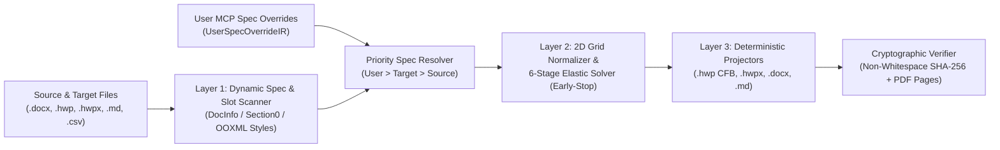

# T-DIR (`document-IR`) — Topological Document Intermediate Representation MCP Server

**[last patch : 2026-11-08 20:15:00 UTC]**

🌐 **[English (./README.md)](./README.md)** | 🇰🇷 **[한국어 (./README_KO.md)](./README_KO.md)**

> [!WARNING]
> **Work in Progress (Experimental Beta — `v3.1.0-beta`)**
> This repository is currently under active development and architectural verification. **It is NOT yet feature-complete or production-hardened.**
> - Several format lifters and projectors (such as direct `<hp:pic>` binary stream embedding inside standalone `.hwpx` packages, full `.xlsx` spreadsheet cell-style lifting, and multi-engine equation AST conversion) are still incomplete.
> - Internal data structures (`SectionIR`, `SlotSpecIR`, `SourceDocumentSpecIR`, `TargetDocumentSpecIR`, `UserSpecOverrideIR`, `ElasticLayoutState`) and MCP tool parameters may undergo breaking changes as beta regression testing progresses.

---

## 1. Overview & Motivation

**T-DIR (Topological Document Intermediate Representation)** is a Model Context Protocol (MCP) server and document transformation engine designed to bridge structural and layout incompatibilities across Korean government/enterprise document formats (**HWP v5.0 Binary `.hwp`**, **OWPML `.hwpx`**) and global document formats (**OOXML `.docx`**, **Markdown `.md`**, **CSV/TSV `.csv`/`.tsv`**).

### Why Traditional 1:1 Document Converters Fail
1. **Box-Model & Coordinate Unit Discrepancies**: Direct translation between `HWPUNIT` ($1\text{ pt} = 100\text{ HU}$), `Twips` ($1\text{ pt} = 20\text{ dxa}$), `EMU` ($1\text{ HU} = 127\text{ EMU}$), and CSS pixels fails when nested tables have asymmetric cell margins, merged spans (`gridSpan` / `vMerge`), or empty decorative spacer columns.
2. **Line-Grid Snap Inflation (`snapToGrid`)**: Fonts with large vertical bounding boxes trigger line-grid snapping in MS Word (`w:lineRule="auto"`), inflating body text height per line and causing content to overflow fixed-page form templates.
3. **Rigid Form Template Boundaries**: Official Korean business plan and grant templates (`.hwp`) wrap each section inside fixed `2x2` outer layout tables and place media attachments in bottom `6x2` grid slots (`붙임`). Naive copy-pasting breaks outer table borders, duplicates headers across pages, or truncates overflowing text.
4. **LLM Context & Token Overhead**: Feeding tens of thousands of lines of raw OOXML (`word/document`) or OWPML (`Contents/section0`) XML into an LLM wastes context window tokens and risks accidental text hallucination or omission.

---

## 2. Core Architecture & Zero-Hardcoding Specification Resolution

T-DIR separates **content semantics**, **dynamic specification resolution**, **2D grid topology**, and **physical metric projection** into strictly isolated layers with **zero hardcoded font names, pixel/HWPUNIT constants, or document-specific strings**:



### 2.1. 3-Tier Specification Priority Resolution
Instead of hardcoding fonts, font sizes, or page dimensions, T-DIR extracts physical specifications from both the target template and source document at runtime and resolves them against explicit user MCP overrides ([`./ir_schema.py`](./ir_schema.py)):

$$\text{EffectiveSpec} = \text{Priority 1 }(\text{UserSpecOverrideIR}) \succ \text{Priority 2 }(\text{TargetDocumentSpecIR}) \succ \text{Priority 3 }(\text{SourceDocumentSpecIR})$$

1. **Priority 1 — `UserSpecOverrideIR` (Explicit User MCP Specification)**: Explicit formatting, typography (body font family, table font family, body font size in points, table font size in points), line spacing percentage bounds, page geometry (page width, height, and margins in millimeters), per-section page budgets, outer table preservation policy, micro-typography scaling toggle, and attachment captions passed by the user or agent via MCP tool calls.
2. **Priority 2 — `TargetDocumentSpecIR` ([`./codec_hwp_v5.py`](./codec_hwp_v5.py))**: Dynamically extracted from the target template's binary streams:
   - `DocInfo` stream: `Tag 19` (UTF-16LE font families), `Tag 21` (character shape font sizes in `HU` and RGB colors), and `Tag 25` (paragraph shape line spacing percentages).
   - `Section0..SectionN` streams: `Tag 73` (page definition width, height, and margins in `HU`), preamble/cover blocks, generalized `NxM` section container tables (outer width, column widths, discovered title text, discovered subtitle text, and available inner width in `HU`), and `6x2` attachment slot geometries (`ATTACH 1..6`).
3. **Priority 3 — `SourceDocumentSpecIR` ([`./codec_ooxml_owpml.py`](./codec_ooxml_owpml.py))**: Dynamically extracted from the source document (`word/styles` and `word/document` `sectPr` in `.docx`, or `DocInfo`/`Section0` in `.hwp`), providing fallback prose/table font families and sizes when the target template's body cells are empty placeholders.

### 2.2. Pure 2D Topological Grid Classifiers ([`./elastic_solver.py`](./elastic_solver.py))
All table and paragraph structural classifications operate purely on 2D matrix geometry and punctuation topology without matching any document-specific text:
- **Stair-Step Sparse Chart Detector**: Detects 2D grids where a single full-width axis row divides upper/lower rows containing sparse single non-empty cells (`1..2` active columns per row) — both before and after empty spacer column removal — and collapses them into a dense 4-row chronological table.
- **Vertical Step-Arrow Detector**: Detects single-column tables (odd row count $\ge 3$) where every odd-indexed row (`r = 1, 3, ...`) is a short connector/arrow indicator ($\le 25$ chars) and folds the connector inline into the preceding step row.
- **Multi-Column Spacer Card Collapser**: Automatically collapses multi-column tables where every non-empty row contains at most 1 non-empty cell into a clean full-width `1`-column card stack.
- **Standalone Subheading Classifier**: Identifies standalone short subheadings ($\le 40$ chars, bold or bracket/bullet-prefixed, not ending with sentence terminal punctuation) for Stage 3 inline lead-in merging.

### 2.3. 6-Stage Minimum-Invasion Elastic Layout Solver (`MinimumInvasionElasticSolver`)
To fit dense source sections into strict page budgets **without over-squishing paragraphs**, `MinimumInvasionElasticSolver` computes East-Asian-Width weighted text units (`CJK` full-width vs. Latin/ASCII half-width) and scales line heights proportionally with the resolved body and table font sizes, executing a progressive 6-stage loop and **stopping immediately (`Early-Stop`)** as soon as the estimated height fits within the target page budget:
- **Stage 1 (Spacers Only)**: Removes empty spacer paragraphs and empty table rows/columns, enforces HWP `Tag 77` non-zero row cell count invariants, and disables document line-grid snapping (`snapToGrid = False`).
- **Stage 2 (Spacing Interpolation Only)**: Interpolates body line spacing and table line spacing between the resolved maximum and minimum percentage bounds while keeping **100% of original paragraph and table cell line breaks intact**.
- **Stage 3 (Subheading Inline Early-Stop)**: Converts standalone short subheadings into bold inline lead-ins (`[Bold Subheading]  [Body Paragraph]`) using whitespace-only joining (`"  "`) so non-whitespace character hashes remain identical.
- **Stage 4 (Partial Cell Merge Early-Stop)**: Sorts multi-paragraph table cells by shortest combined character length and merges one adjacent pair at a time, checking the height budget after **every single merge**.
- **Stage 5 (Minimal Body Continuation Early-Stop)**: Only if still over budget after Stage 4, merges the shortest adjacent body continuation paragraphs one by one until the page budget is met.
- **Stage 6 (Optional Micro-Typography Font Scaling)**: When explicitly enabled via `UserSpecOverrideIR`, applies a bounded `-50 HU` (`-0.5pt`) micro-typography step if Stage 5 still exceeds the page budget.

---

## 3. Repository Structure

| Module Path | Description |
| :--- | :--- |
| [`./__init__.py`](./__init__.py) | Package initialization and exported classes (`TdirBetaMcpServer`, `MinimumInvasionElasticSolver`, `SourceDocumentSpecIR`, `TargetDocumentSpecIR`, `UserSpecOverrideIR`). |
| [`./ir_schema.py`](./ir_schema.py) | T-DIR v3.1 data structures (`TextRunIR`, `ParagraphIR`, `TableCellIR`, `TableGridIR`, `MediaObjectIR`, `SectionIR`, `SlotSpecIR`, `SourceDocumentSpecIR`, `TargetDocumentSpecIR`, `UserSpecOverrideIR`, `ConversionJobIR`), dynamic specification priority resolver, magic-byte image detector, CJK/Latin width estimator, and cryptographic non-whitespace `SHA-256` verifier. |
| [`./cfb_ole2.py`](./cfb_ole2.py) | Pure-Python MS-CFB (`CFBArchive` OLE2 Compound File Binary v3) reader and writer supporting 512B standard sectors, 64B mini-streams, `DIFAT` sector chains (`> 6.8 MB`), exact fixed-point FAT allocation, automatic `BinData` storage creation, and balanced Red-Black directory trees. |
| [`./elastic_solver.py`](./elastic_solver.py) | Pure topological 2D grid normalizers and `MinimumInvasionElasticSolver` 6-stage Early-Stop layout engine (`ElasticLayoutState`). |
| [`./codec_hwp_v5.py`](./codec_hwp_v5.py) | HWP v5.0 binary record parser (compressed & uncompressed streams, multi-section `Section0..SectionN`), `DocInfo` dynamic typography extractor, UTF-16LE surrogate-pair safe `WCHAR` accounting, dynamic font face registrar, `Section0` template slot scanner, lifter, and binary projector. |
| [`./codec_ooxml_owpml.py`](./codec_ooxml_owpml.py) | OOXML (`.docx`) style/page scanner, `<w:sdt>` content control unwrapper, recursive nested table extractor, standalone `.docx` package synthesizer, and `TargetDocumentSpecIR`-driven `.docx` / `.hwpx` projectors. |
| [`./codec_tabular_markup.py`](./codec_tabular_markup.py) | Markdown (`.md` with code-fence state machine and escaped-pipe table parser) and Tabular (`.csv`, `.tsv`) lifters and projectors. |
| [`./mcp_server.py`](./mcp_server.py) | Standalone JSON-RPC 2.0 stdio MCP server (`TdirBetaMcpServer` / `tdir-document-beta`) exposing 5 tools, multi-source section deduplication, similarity-based slot matching, and the `UserSpecOverrideIR` JSON schema. |
| [`./test_regression_suite.py`](./test_regression_suite.py) | End-to-end regression suite verifying dynamic typography/slot probing, `UserSpecOverrideIR` priority overrides, Early-Stop solving, multi-format projection, `SHA-256` text immutability, 8-page PDF boundary compliance, and `v3.1.0-beta` edge-case checks. |

---

## 4. MCP Tools & `UserSpecOverrideIR` Schema

The server ([`./mcp_server.py`](./mcp_server.py)) communicates over standard JSON-RPC 2.0 (`stdio`) and exposes 5 tools:

```python
# 1. Probe source documents and target template typography, page geometry, and slots dynamically
tdir_probe_files(source_paths: list[str], target_path: str) -> dict

# 2. Resolve effective spec (UserSpecOverrideIR > TargetDocumentSpecIR > SourceDocumentSpecIR) and preview Elastic Solver
tdir_build_mapping_plan(
    job_id: str,
    user_spec_overrides: dict | None = None,
    user_constraints: dict | None = None,
) -> dict

# 3. Execute deterministic projection into ["hwp", "hwpx", "docx", "md"]
tdir_execute_conversion(
    job_id: str,
    output_prefix: str,
    output_formats: list[str] | None = None,
    page_body_height_hu: int | None = None,
    base_hwpx_path: str | None = None,
    user_spec_overrides: dict | None = None,
) -> dict

# 4. Verify 100.00% non-whitespace SHA-256 text immutability and rendered PDF page count
tdir_verify_fidelity_and_layout(job_id: str, export_pdf: bool = True) -> dict

# 5. Pinpoint adjustment of paragraph merge lock or table column widths with immediate solver preview refresh
tdir_adjust_block_layout(
    job_id: str,
    section_uid: str,
    block_index: int,
    lock_unmerged: bool | None = None,
    col_widths_hu: list[int] | None = None,
) -> dict
```

### Supported `UserSpecOverrideIR` Fields
When calling Tool 2 or Tool 3, users or agents can pass the override dictionary to explicitly override any aspect of the target specification:

```json
{
  "body_font_family": "함초롬바탕",
  "table_font_family": "함초롬돋움",
  "body_font_size_pt": 11.5,
  "table_font_size_pt": 9.5,
  "body_line_spacing_min_pct": 122,
  "body_line_spacing_max_pct": 160,
  "table_line_spacing_min_pct": 112,
  "table_line_spacing_max_pct": 125,
  "page_width_mm": 210.0,
  "page_height_mm": 297.0,
  "margins_mm": {"top": 15.0, "bottom": 15.0, "left": 20.0, "right": 20.0},
  "section_page_budgets": {"Q1": 2.0, "Q2": 2.0},
  "exclude_sections": ["PREAMBLE", "Q3", "Q4", "REFERENCES"],
  "preserve_outer_tables": true,
  "route_media_to_attachment_slots": true,
  "max_attachment_images": 3,
  "attachment_captions": [
    "[붙임 1] 시스템 아키텍처 다이어그램",
    "[붙임 2] 3단계 워크플로우 및 타겟 시장 로드맵"
  ],
  "allow_font_size_elastic_scaling": false,
  "clear_unmapped_slots": false,
  "style_inheritance_mode": "TARGET_FIRST"
}
```

---

## 5. Quickstart & Usage

### Prerequisites
- Python 3.10+ (Zero external third-party pip dependencies required for core `.hwp`, `.hwpx`, `.docx`, `.md`, `.csv` lifting and projection; uses Python standard library modules `zlib`, `struct`, `zipfile`, `hashlib`).
- Optional: Microsoft Word (on Windows) if headless PDF page-count verification is enabled in Tool 4.

### Running as an MCP Server
Add `tdir-document-beta` to your MCP client configuration:

```json
{
  "mcpServers": {
    "tdir-document-beta": {
      "command": "python",
      "args": ["mcp_server.py"],
      "cwd": "/path/to/-document-IR"
    }
  }
}
```

---

## 6. `v3.1.0-beta` Debugging & Edge-Case Hardening Log + Roadmap

### 6.1. Resolved in `v3.1.0-beta` (`P0` & `P1` Patch Set)
1. **Stair-Step Sparse Chart Pre/Post-Spacer Compression (`[BUG-01]`, `[BUG-02]`)**: Fixed row-count check in [`./elastic_solver.py`](./elastic_solver.py) (`MinimumInvasionElasticSolver`) so stair-step chronological charts are detected and collapsed even after empty spacer columns are stripped. Reduced `Q1` table cell paragraph merges from 17 pairs down to **6 pairs** while maintaining exact 8-page compliance.
2. **UTF-16LE Surrogate Pair & 16-Bit `WCHAR` Accounting (`[BUG-03]`)**: Fixed [`./codec_hwp_v5.py`](./codec_hwp_v5.py) to decode surrogate pairs (emojis and supplementary CJK ideographs) intact and count 16-bit `WCHAR` units in `Tag 66` and `Tag 68`.
3. **Magic-Byte Image Format & MIME Detection (`[BUG-04]`)**: Added magic-byte header inspection in [`./ir_schema.py`](./ir_schema.py) (`PNG`, `JPEG`, `BMP`, `GIF`, `WEBP`, `EMF`, `WMF`) for dynamic `BinData` extension packing in `.hwp` and `MediaObjectIR` lifting in `.docx`.
4. **Large `.hwp` (`> 6.8 MB`) `DIFAT` Chain & Automatic `BinData` Storage Creation (`[BUG-05]`, `[BUG-06]`)**: Upgraded [`./cfb_ole2.py`](./cfb_ole2.py) (`CFBArchive`) with full `DIFAT` sector chain reading/writing, exact fixed-point FAT sector calculation, and automatic `BinData` directory entry creation when a template lacks an existing `BinData` storage.
5. **Explicit Margin Override Unclamping & Standalone `.docx` Synthesis (`[BUG-07]`, `[BUG-08]`, `[BUG-09]`)**: Updated [`./codec_ooxml_owpml.py`](./codec_ooxml_owpml.py) to honor explicit margin overrides (`UserSpecOverrideIR`) without clamping, synthesize self-contained `.docx` ZIP packages when converting from non-DOCX sources (`.md`, `.csv`, `.hwp`), and preserve underline formatting across `.hwp`, `.hwpx`, and `.docx`.
6. **Edge-Case & Multi-Source Hardening (`[EDGE-01]` ~ `[EDGE-08]`, `[BUG-10]` ~ `[BUG-12]`, `[GEN-01]` ~ `[GEN-05]`)**: Added recursive nested table paragraph lifting and `<w:sdt>` unwrapping in `.docx`, HWP `Tag 77` non-zero row cell count enforcement, East-Asian-Width CJK/Latin line-wrap estimation, multi-section (`Section0..SectionN`) and uncompressed HWP stream support, Markdown code-fence and escaped-pipe (`\|`) state machine, multi-source section UID deduplication, similarity-based section-to-slot matching, immediate solver preview refresh in Tool 5 (`TdirBetaMcpServer`), and `try/finally` Word COM cleanup in Tool 4.

### 6.2. Upcoming Roadmap (`P2` & `P3`)
1. **Standalone `.hwpx` Binary Image Injection (`P2`)**: Direct `<hp:pic>` XML and `BinData/` ZIP entry injection for standalone `.hwpx` output.
2. **Bidirectional Equation AST Compiler (`P2`)**: Lossless AST translation across MS Word `OMML` (`<m:oMath>`), Hancom `HWP EQN` (`Tag 71`), and `LaTeX`.
3. **Full `.xlsx` & `.html` DOM Lifters/Projectors (`P3`)**: Styled spreadsheet and HTML table/document projection.
4. **Cross-Platform Headless Layout Verification (`P3`)**: LibreOffice / headless Chromium fallback for non-Windows environments alongside Windows Word/HWP COM verification.
