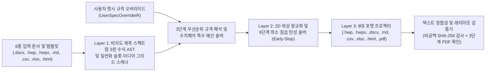

# SADT (Stella Actuation Document Transfer) — 한글(HWP·HWPX) · 워드(DOCX) 문서 변환 MCP 서버

[](./LICENSE)
[](./pyproject.toml)
[-00C853.svg)](./pyproject.toml)
[](./server.json)
[](./README_KO.md)

**[last patch : 2026-11-16 07:43:00 UTC]**

🌐 **[English (./README.md)](./README.md)** | 🇰🇷 **[한국어 (./README_KO.md)](./README_KO.md)** | 🤖 **[에이전트 요약 (./llms.txt)](./llms.txt)** | 📋 **[MCP 매니페스트 (./server.json)](./server.json)** | 🌐 **[공식 소개 허브](https://salabs.quanxs.com/tools/sadt-hwp-hwpx-document-mcp-hub.html)**

> [!NOTE]
> **지속 개선 중인 오픈소스 프로젝트 (`v4.1.0`) — 기능 범위 및 한계 안내**
> **SADT (Stella Actuation Document Transfer)**는 위상 보존 문서 중간 표현 엔진 **T-DIR**을 기반으로 활발히 고도화되고 있는 오픈소스 프로젝트입니다. 8종 포맷(`.hwp`, `.hwpx`, `.docx`, `.xlsx`, `.html`, `.pdf`, `.md`, `.csv`) 상호 변환, 단독 `.hwpx` 생성, 3원 수식 AST 번역, 아카이브 보안 검사(`[SEC-01]` ~ `[SEC-06]`), 14종 회귀 테스트 코호트(`EXP-01` ~ `EXP-14`)가 검증되었습니다. 다만 암호화/DRM 걸린 문서, 레거시 스크립트 매크로, 복잡하게 겹친 부동 도형 레이아웃 등은 변환 후 오피스 프로그램에서의 육안 확인이 필요할 수 있습니다.

---

## 1. 30초 만에 이해하는 SADT

**SADT (Stella Actuation Document Transfer)**는 한컴오피스나 리브레오피스 설치 없이 **파이썬 표준 라이브러리만으로 동작하는 8대 포맷 문서 변환 엔진 겸 MCP(Model Context Protocol) 서버**입니다.

### 주로 해결하는 문제
- **"Mac이나 Linux 환경에서 한컴오피스 없이 `.hwp`·`.hwpx` 문서를 `.docx`나 Markdown으로 다루고 싶어요."**  
  순수 파이썬 MS-CFB OLE2 파서·빌더([`./cfb_ole2.py`](./cfb_ole2.py))와 HWP v5.0 / OWPML 코덱([`./codec_hwp_v5.py`](./codec_hwp_v5.py), [`./codec_ooxml_owpml.py`](./codec_ooxml_owpml.py))이 외부 패키지 설치 없이 직접 바이너리 스트림과 XML 아카이브를 읽고 씁니다.
- **"AI 에이전트가 공공기관·사업계획서 HWP 양식의 외곽 표나 쪽수를 깨뜨리지 않고 내용을 채울 수 있나요?"**  
  수만 줄 XML을 LLM에 직접 넣는 대신, 템플릿의 섹션 슬롯(`SLOT 01..M`)과 첨부 그리드(`MEDIA 01..P`)를 자동 스캔하고 6단계 `MinimumInvasionElasticSolver`로 쪽수 예산에 맞춰 조판한 뒤 비공백 `SHA-256` 해시로 텍스트 보존 여부를 확인합니다.
- **"워드(`OMML`), 한글(`HWP EQN`), 마크다운(`LaTeX`) 사이의 수식과 병합된 표도 깨지지 않나요?"**  
  공통 수식 AST 컴파일러([`./ir_schema.py`](./ir_schema.py))로 3원 수식 표기를 상호 변환하며, 병합 셀·중첩 표 구조를 위상 그래프 단위로 유지합니다.

---

## 2. 빠른 시작 (클론 없는 `uvx` / `pip` 원라인 실행 또는 로컬 실행)

### 방법 A — 클론 없이 `uvx` 또는 `pip` 원라인 실행 (권장)
외부 패키지 설치 없이 GitHub에서 즉시 `sadt-mcp`를 실행할 수 있습니다.

```bash
# 1. 클론 없이 uvx로 MCP stdio 서버 즉시 실행
uvx --from git+https://github.com/Team-Sequence-Thaumaturge/-document-IR sadt-mcp

# 2. 또는 pip로 GitHub 저장소 직접 설치 후 실행
pip install git+https://github.com/Team-Sequence-Thaumaturge/-document-IR.git
sadt-mcp
```

Claude Desktop, Cursor, Windsurf, Antigravity 등의 MCP 설정에 아래 JSON을 그대로 붙여넣어 연동하세요:

```json
{
  "mcpServers": {
    "sadt-mcp": {
      "command": "uvx",
      "args": [
        "--from",
        "git+https://github.com/Team-Sequence-Thaumaturge/-document-IR",
        "sadt-mcp"
      ]
    }
  }
}
```

### 방법 B — 로컬 클론 및 개발 실행
```bash
git clone https://github.com/Team-Sequence-Thaumaturge/-document-IR.git
cd -document-IR

# 개발 모드 설치 또는 Python 3.10+ 단독 실행
pip install -e .
sadt-mcp
# 또는: python mcp_server.py
```

> [!TIP]
> **[Quanxs SA Labs — SADT 공식 허브](https://salabs.quanxs.com/tools/sadt-hwp-hwpx-document-mcp-hub.html)** 페이지에서도 한/영 가이드와 1클릭 MCP 설정 복사를 바로 이용하실 수 있습니다. 상세 에이전트 규격은 [`./llms.txt`](./llms.txt)와 [`./server.json`](./server.json)을 참고하세요.

---

## 3. 기존 문서 도구와의 비교

| 비교 항목 | **SADT (`sadt-mcp`)** | `pyhwp` / `olefile` | `pandoc` | `python-docx` |
| :--- | :--- | :--- | :--- | :--- |
| **순수 파이썬 `.hwp` v5.0 읽기·쓰기** | 읽기 + 양식 템플릿 쓰기 지원 (`CFBArchive`) | 주로 읽기 및 텍스트 추출 | 미지원 | 미지원 |
| **단독 `.hwpx` 패키지 생성** | 참조 파일 없이 단독 생성 및 이미지 주입 | 미지원 | 미지원 | 미지원 |
| **지원 포맷 범위** | 8종 (`.hwp`, `.hwpx`, `.docx`, `.xlsx`, `.html`, `.pdf`, `.md`, `.csv`) | HWP 중심 | 텍스트 / DOCX / HTML / LaTeX | `.docx` 단일 포맷 |
| **3원 수식 AST 상호 번역** | `OMML` $\leftrightarrow$ `HWP EQN` $\leftrightarrow$ `LaTeX` | 제한적 | HWP 수식 미지원 | 원문 XML 직접 조작 |
| **양식 슬롯 탐색 및 쪽수 자동 맞춤** | 비지도 제목·그리드 스캐너 + 6단계 탄성 솔버 | 미제공 | 미제공 | 미제공 |
| **네이티브 MCP (`stdio`) 서버** | 내장 (5대 툴 + JSON-RPC 2.0) | CLI / 파이썬 API | CLI 전용 | 파이썬 API 전용 |
| **외부 패키지 의존성** | 없음 (Python 3.10+ 표준 라이브러리만 사용) | 외부 의존성 필요 | Haskell 바이너리 필요 | `lxml` 필요 |

---

## 4. 핵심 아키텍처 (하드코딩 없는 동적 규격 해석)

SADT는 문서 내 **콘텐츠 위상**, **규격 우선순위 해석**, **수식 AST 컴파일**, **수치해석 쪽수 배분**, **포맷별 프로젝션**을 계층 분리하여 특정 폰트명, 픽셀 상수, 섹션 이름(`Q1..Q4`), 고정 쪽수 등을 코드에 하드코딩하지 않습니다.



### 4.1. 3단계 규격 우선순위 해석
폰트 패밀리, 본문·표 글자 크기, 여백, 용지 규격은 [`./ir_schema.py`](./ir_schema.py)의 우선순위 규칙에 따라 결합됩니다.

$$\text{EffectiveSpec} = \text{Priority 1 }(\text{UserSpecOverrideIR}) \succ \text{Priority 2 }(\text{TargetDocumentSpecIR}) \succ \text{Priority 3 }(\text{SourceDocumentSpecIR})$$

1. **Priority 1 — `UserSpecOverrideIR`**: 사용자 또는 에이전트가 MCP 호출 시 넘긴 명시적 설정(본문·표 폰트 및 크기(pt), 줄간격 상·하한 비율, 용지 가로·세로 및 여백(mm), 총 쪽수 상한, 섹션별 쪽수 예산, 외곽 표 유지 여부, 첨부 캡션 등).
2. **Priority 2 — `TargetDocumentSpecIR` ([`./codec_hwp_v5.py`](./codec_hwp_v5.py))**: 타겟 HWP 템플릿 바이너리에서 런타임에 추출한 폰트/글자/문단 규격(`Tag 19`, `Tag 21`, `Tag 25`), 용지 정의(`Tag 73`), 표지 블록, 외곽 섹션 슬롯(`SLOT 01..M`), 교번 미디어 그리드(`MEDIA 01..P`).
3. **Priority 3 — `SourceDocumentSpecIR` ([`./codec_ooxml_owpml.py`](./codec_ooxml_owpml.py))**: `.docx`, `.hwpx`, `.hwp` 원본에서 추출한 대표 폰트·크기로, 타겟 셀이 비어 있을 때 자동 승계됩니다.

### 4.2. 비지도 제목 스펙트럼 및 일반화 슬롯 탐색
- **비지도 대단원 제목 탐지**: 문단 글자 크기의 통계적 최빈값 $S_{\text{mode}}$를 계산하고 개요 수준(`outlineLvl`), 구조적 접두사(`제1장`, `I.`, `Ⅰ.`, `Chapter 1`, `Q1.`), 또는 굵은 글씨 크기 도약($\ge S_{\text{mode}} + 150\text{ HU}$)을 결합해 섹션(`SEC 01..K`, `PREAMBLE`, `REFERENCES`)을 자동 분리합니다.
- **범용 섹션·슬롯 셀렉터**: `UserSpecOverrideIR`에서 일반 ID(`SEC 01`), 슬롯 ID(`SLOT 01`), 서수 인덱스(`1`, `"2"`), 제목 부분 문자열을 모두 매칭하며 특정 문서 전용 기본 제외 목록을 두지 않습니다.
- **일반화된 $2R \times C$ 미디어 그리드 스캐너**: 이미지 행($H_{2r} \ge 3000\text{ HU}$)과 캡션 행($H_{2r} \ge 2 \cdot H_{2r+1}$)이 교번하는 짝수 행 표($R \ge 1, 1 \le C \le 4$)를 찾아 `MEDIA 01..P` (`SlotSpecIR`)로 등록합니다.

### 4.3. 탄성 레이아웃 솔버 및 다중 포맷 코덱
- **6단계 `MinimumInvasionElasticSolver` ([`./elastic_solver.py`](./elastic_solver.py))**: 빈 스페이서 정리(**Stage 1**) $\to$ 줄간격 미세 보간(**Stage 2**) $\to$ 단독 소제목 인라인 결합(**Stage 3**) $\to$ 최소 길이 표 셀 문단 쌍 결합(**Stage 4**) $\to$ 본문 연속 문단 최소 결합(**Stage 5**) $\to$ 선택적 `-0.5pt` 폰트 축소(**Stage 6**) 순으로 최소 침습 조정을 수행하며, 목표 쪽수 예산 이하가 되면 즉시 중단(`Early-Stop`)합니다.
- **단독 `.hwpx` 생성 및 양방향 리프팅**: 참조 `.hwpx` 파일 없이도 `mimetype`, `META-INF/container`, `Contents/content`, `Contents/header`, `Contents/section0` 패키지와 `<hp:pic>` / `Contents/BinData/` 이미지를 직접 생성하며, 기존 `.hwpx` 문서의 표·이미지·수식을 `SectionIR`로 역추출합니다.
- **3원 수식 AST 번역**: MS Word `OMML`(`<m:oMath>`), 한컴 `HWP EQN`(`Tag 105` 및 `<hp:equation>`), `LaTeX`(`$...$` / `$$...$$`, `<math data-latex="...">`) 간 공통 AST 변환을 지원합니다.
- **양방향 `.xlsx` · `.html` 및 순수 파이썬 PDF 1.4**: 공유 문자열, `<mergeCells>`, `rowspan`/`colspan`, base64 이미지를 처리하며, UTF-16BE(`<FEFF...>`) 한글 스트림 기반 PDF 1.4 출력과 3단계 PDF 검증(**Tier 1** MS Word COM $\to$ **Tier 2** LibreOffice $\to$ **Tier 3** 내장 PDF 1.4)을 제공합니다.

### 4.4. 보안 및 실행 상태 격리 검사 (`[SEC-01]` ~ `[SEC-06]`)
- `[SEC-01]` XML `DOCTYPE` / `ENTITY` 선언 거부(XXE 방어) 및 `64 MB` XML 상한 검사.
- `[SEC-02]` ZIP 경로 이탈(`../`, 드라이브 문자열) 차단, 엔트리 수(`4,096`)·압축 해제 크기(`64 MB`/파일, `256 MB`/전체) 제한, HWP 스트림 청크 상한(`64 MB`) `zlib` 해제.
- `[SEC-03]` MS-CFB 헤더 확인, 디렉토리(`8,192`)·스트림(`128 MB`) 상한, `DIFAT`/`FAT`/`MiniFAT` 순환 방어용 방문 집합 적용(`CFBArchive`).
- `[SEC-04]` Null 바이트 및 Windows 예약 장치명 경로 차단.
- `[SEC-05]` XML 비허용 제어문자 제거 및 스프레드시트 수식 인젝션 접두사(`=`, `+`, `-`, `@`) 앞 `'` 이스케이프 처리.
- `[SEC-06]` 솔버 진입 전 `SectionIR` 블록 깊은 복사 격리로 동일 Job 반복 실행 시 상태 잔류 방지 및 `64`-Job LRU 캐시 관리(`TdirBetaMcpServer`).

---

## 5. 레포지토리 구성 파일

| 모듈 경로 | 역할 및 설명 |
| :--- | :--- |
| [`./pyproject.toml`](./pyproject.toml) | PEP 621 무의존성 패키징 명세(`sadt-mcp`) 및 `sadt-mcp` / `sadt` / `tdir-mcp` CLI 엔트리포인트 |
| [`./server.json`](./server.json) | 공식 MCP 레지스트리 등록용 표준 매니페스트 및 `uvx` 실행 정보 |
| [`./smithery.yaml`](./smithery.yaml) | Smithery MCP `stdio` 실행 설정 파일 |
| [`./llms.txt`](./llms.txt) | AI 검색 엔진 및 크롤러(GEO)용 핵심 요약 인덱스 |
| [`./llms-full.txt`](./llms-full.txt) | 에이전트용 전체 스키마, 파라미터 명세, 비교 분석 및 제약 사항 가이드 |
| [`./__init__.py`](./__init__.py) | `v4.1.0` 패키지 초기화 및 `SadtMcpServer` / `TdirBetaMcpServer` 등 주요 클래스 익스포트 |
| [`./ir_schema.py`](./ir_schema.py) | T-DIR IR 데이터클래스, 3원 수식 AST 컴파일러, 보안 검증 함수(`[SEC-01]`..`[SEC-05]`), 제목 탐지기 및 비공백 `SHA-256` 비교기 |
| [`./cfb_ole2.py`](./cfb_ole2.py) | 순수 파이썬 MS-CFB (`CFBArchive` OLE2 Compound File Binary v3) 파서 및 빌더 (`DIFAT`/`FAT`/`MiniFAT` 순환 방어 포함) |
| [`./elastic_solver.py`](./elastic_solver.py) | 2D 표 정규화기, 수치해석 쪽수 예산 배분기 및 6단계 조기 종료 `MinimumInvasionElasticSolver` |
| [`./codec_hwp_v5.py`](./codec_hwp_v5.py) | HWP v5.0 바이너리 레코드 파서, `DocInfo` 추출기, `Tag 105` 수식 코덱, 서로게이트 페어 안전 `WCHAR` 인코더 및 일반화 슬롯 스캐너·프로젝터 |
| [`./codec_ooxml_owpml.py`](./codec_ooxml_owpml.py) | OOXML(`.docx`) 및 OWPML(`.hwpx`) 리프터, 스캐너, 수식 처리기 및 단독 `.docx` / `.hwpx` 생성 프로젝터 |
| [`./codec_tabular_markup.py`](./codec_tabular_markup.py) | Markdown, CSV/TSV, Excel(`.xlsx`), HTML5(`.html`), 내장 PDF 1.4 양방향 코덱 |
| [`./mcp_server.py`](./mcp_server.py) | JSON-RPC 2.0 `stdio` 독립 MCP 서버 (`SadtMcpServer` / `TdirBetaMcpServer` `sadt-mcp` `v4.1.0`, 단독 스크립트 실행 및 패키지 임포트 양쪽 지원) |
| [`./test_regression_suite.py`](./test_regression_suite.py) | **14종 파라메트릭 회귀 검증 스위트 (`EXP-01` ~ `EXP-14`)** |

---

## 6. MCP 5대 툴 및 `UserSpecOverrideIR` 명세

서버([`./mcp_server.py`](./mcp_server.py))는 표준 JSON-RPC 2.0(`stdio`)을 통해 아래 5개 툴을 제공합니다.

```python
# 1. 원본 문서(.docx, .hwp, .hwpx, .md, .csv, .tsv, .xlsx, .html) 및 타겟 템플릿 동적 프로빙
tdir_probe_files(source_paths: list[str], target_path: str) -> dict

# 2. 규격 우선순위 해석, 슬롯 매핑 및 수치해석 쪽수 예산 프리뷰
tdir_build_mapping_plan(
    job_id: str,
    user_spec_overrides: dict | None = None,
    user_constraints: dict | None = None,
) -> dict

# 3. 8대 포맷(["hwp", "hwpx", "docx", "md", "csv", "xlsx", "html", "pdf"]) 변환 실행
tdir_execute_conversion(
    job_id: str,
    output_prefix: str,
    output_formats: list[str] | None = None,
    page_body_height_hu: int | None = None,
    base_hwpx_path: str | None = None,
    user_spec_overrides: dict | None = None,
) -> dict

# 4. 비공백 SHA-256 텍스트 일치 검사 및 3단계 크로스 플랫폼 PDF 쪽수 확인
tdir_verify_fidelity_and_layout(job_id: str, export_pdf: bool = True) -> dict

# 5. 특정 문단 병합 잠금 또는 표 열 폭 핀포인트 미세 조정
tdir_adjust_block_layout(
    job_id: str,
    section_uid: str,
    block_index: int,
    lock_unmerged: bool | None = None,
    col_widths_hu: list[int] | None = None,
) -> dict
```

### `UserSpecOverrideIR` 주요 옵션 예시
```json
{
  "body_font_family": "함초롬바탕",
  "table_font_family": "함초롬돋움",
  "body_font_size_pt": 11.5,
  "table_font_size_pt": 9.5,
  "body_line_spacing_min_pct": 122,
  "body_line_spacing_max_pct": 160,
  "page_width_mm": 210.0,
  "page_height_mm": 297.0,
  "margins_mm": {"top": 15.0, "bottom": 15.0, "left": 20.0, "right": 20.0},
  "total_page_limit": 8,
  "section_page_budgets": {"SEC_01": 2.0, "SEC_02": 2.0},
  "preserve_outer_tables": true,
  "route_media_to_attachment_slots": true,
  "max_attachment_images": 3,
  "allow_font_size_elastic_scaling": false,
  "style_inheritance_mode": "TARGET_FIRST"
}
```

---

## 7. 14종 파라메트릭 회귀 검증 결과 ([`./test_regression_suite.py`](./test_regression_suite.py))

| 코호트 ID | 실험 범위 | 검증 결과 |
| :--- | :--- | :--- |
| **`EXP-01`** | 문서 계층 및 비지도 제목 스펙트럼 탐지 (`제1장..제3장`, `I..III`, 폰트 크기 점프, 실문서 양식) | `PASS` |
| **`EXP-02`** | 수치해석 쪽수 예산 스윕 및 병합 단조성 (`3p` `0`회, 자율 `8`쪽 `11`회, `1p` `108`회, 비대칭 `4:1`) | `PASS` |
| **`EXP-03`** | `HWPUNIT` 연속 메트릭 스케일링 (`A4 가로` `9pt` vs `B5 세로` `13.5pt`) | `PASS` |
| **`EXP-04`** | 2D 표 위상 정규화 스트레스 (`5x4` 계단형 압축 $\to$ `3x3`, 수직 화살표 폴딩 `3x1` $\to$ `2x1`, `<w:sdt>`) | `PASS` |
| **`EXP-05`** | 일반화 `4x2` 미디어 그리드 탐지, `BinData` 자동 생성 및 비슬롯 문서 모드 | `PASS` |
| **`EXP-06`** | N대M 교차 포맷 왕복 변환 (`.docx` $\to$ `.md`, `.docx` $\to$ `.csv`) | `PASS` |
| **`EXP-07`** | UTF-16LE 서로게이트 페어 `WCHAR` 계수(`"A🚀B𝕏\r"`) 및 `7.2 MB` `DIFAT` 체인 검증 | `PASS` |
| **`EXP-08`** | 다중 이기종 소스 통합(`[.docx, .csv, .md]`) 및 Tool 5 문단 잠금·열 폭 조정 루프 | `PASS` |
| **`EXP-09`** | 단독 `.hwpx` 패키지 합성(`<hp:pic>` 이미지 주입) 및 `.hwpx` $\to$ `.hwp`/`.docx` 왕복 변환 | `PASS` |
| **`EXP-10`** | 3원 수식 AST 번역 (`OMML`, `HWP EQN` `Tag 105`·`<hp:equation>`, `LaTeX`) | `PASS` |
| **`EXP-11`** | 양방향 `.xlsx` (`106`행, `<mergeCells>`) 및 `.html` (`rowspan`/`colspan`, base64 미디어) 왕복 검증 | `PASS` |
| **`EXP-12`** | 내장 순수 파이썬 PDF 1.4 (`8`쪽) 렌더링 및 UTF-16BE(`<FEFF...>`) 텍스트 역추출 정합성 | `PASS` |
| **`EXP-13`** | 보안·멱등성 검사(`[SEC-01]`..`[SEC-06]`): XXE 차단, `Zip-Slip` 차단, `MiniFAT` 순환 종료, DDE 이스케이프 | `PASS` |
| **`EXP-14`** | 단독 `python mcp_server.py` `stdio` 초기화(`sadt-mcp` `v4.1.0`), PEP 621 패키징 및 GEO 매니페스트 검증 | `PASS` |

---

## 8. 자주 묻는 질문 (FAQ)

- **한컴오피스나 MS Word를 반드시 설치해야 하나요?**  
  아니요. `.hwp`, `.hwpx`, `.docx`, `.xlsx`, `.html`, `.pdf`, `.md`, `.csv` 변환 핵심 파이프라인은 외부 프로그램 없이 macOS, Linux, Windows의 Python 3.10+ 표준 라이브러리만으로 동작합니다. Word COM 또는 LibreOffice는 PDF 렌더링 확인 시 선택적으로 활용되며, 없는 환경에서는 내장 PDF 1.4 검증기가 작동합니다.
- **참조 `.hwpx` 파일 없이도 `.hwpx` 결과물을 만들 수 있나요?**  
  네. `.hwp` 양식 템플릿의 `SLOT 01..M`을 채워 투영하거나, 참조 `.hwpx` 없이 단독 `.hwpx` 패키지를 바로 생성할 수 있습니다.
- **양식 페이지 수를 넘기는 긴 본문은 어떻게 처리되나요?**  
  6단계 `MinimumInvasionElasticSolver`가 줄간격 보간, 짧은 소제목 인라인 결합, 최소 길이 연속 문단 병합 순으로 조정하여 텍스트 누락을 줄이면서 목표 쪽수 예산에 맞춥니다.
