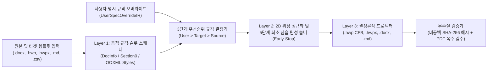

# T-DIR (`document-IR`) — 위상 보존 문서 중간 표현(Topological Document IR) 기반 MCP 서버

**[last patch : 2026-11-08 17:52:00 UTC]**

🌐 **[English (./README.md)](./README.md)** | 🇰🇷 **[한국어 (./README_KO.md)](./README_KO.md)**

> [!WARNING]
> **개발 진행 중 안내 (Work in Progress / Experimental Beta — `v3.0.0-beta`)**
> 본 레포지토리는 현재 활발히 개발 및 아키텍처 검증이 진행 중인 **실험적 베타(Beta) 버전**으로, **아직 모든 기능이 완성된 상태가 아닙니다.**
> - 단독 `.hwpx` 컨테이너 내부의 `<hp:pic>` 바이너리 이미지 스트림 직접 주입, `.xlsx` 스프레드시트 셀 스타일 리프팅, 수식 AST(`LaTeX` $\leftrightarrow$ `HWP EQN` $\leftrightarrow$ `OMML`) 양방향 컴파일러 등 일부 기능은 현재 구현 및 고도화 진행 중입니다.
> - 베타 회귀 검증 과정에서 내부 IR 스키마(`SectionIR`, `SlotSpecIR`, `SourceDocumentSpecIR`, `TargetDocumentSpecIR`, `UserSpecOverrideIR`, `ElasticLayoutState`) 및 MCP 툴 인터페이스가 예고 없이 변경될 수 있습니다.

---

## 1. 프로젝트 개요 및 배경 (Overview & Motivation)

**T-DIR (Topological Document Intermediate Representation)**은 한국 공공기관·기업 표준 문서 포맷(**한글 HWP v5.0 바이너리 `.hwp`**, **개방형 한글 `.hwpx`**)과 글로벌 문서 포맷(**MS Word `.docx`**, **Markdown `.md`**, **CSV/TSV `.csv`/`.tsv`**) 간의 구조적·기하학적 이질성을 해결하기 위해 설계된 문서 중간 표현(IR) 엔진이자 **MCP (Model Context Protocol) 서버**입니다.

### 기존 1:1 문서 변환 방식의 한계점
1. **박스 모델(Box-Sizing) 및 물리 좌표계 불일치**: `HWPUNIT`($1\text{ pt} = 100\text{ HU}$), `Twips`($1\text{ pt} = 20\text{ dxa}$), `EMU`($1\text{ HU} = 127\text{ EMU}$), 픽셀 단위를 단순 1:1 치환할 경우 중첩 표의 셀 여백, 셀 병합(`gridSpan` / `vMerge`), 장식용 빈 스페이서 열에서 오차가 누적되어 표가 깨지거나 문단 폭이 어긋납니다.
2. **문서 그리드 스냅(`snapToGrid`)에 의한 줄간격 팽창**: 상하 메트릭이 큰 한글 폰트를 MS Word/한글의 기본 줄 그리드 스냅(`w:lineRule="auto"`) 상태로 두면 본문 1줄 높이가 과도하게 팽창하여 고정 양식 페이지 밖으로 넘치는 하단 잘림 현상이 발생합니다.
3. **고정 양식 템플릿(`2x2` 본문 표 및 `6x2` 첨부 표) 파손**: 정부지원사업 사업계획서 등 한국형 양식 문서는 각 문항(`Q1`, `Q2`, `Q3`, `Q4`)이 외곽 `2x2` 고정 표 내부에 들어가고 이미지가 최하단 `붙임` `6x2` 규격 표에 순서대로 배치되어야 합니다. 단순 복사·붙여넣기 시 외곽 표가 임의로 쪼개지거나 쪽마다 헤더가 반복 출력되는 문제가 발생합니다.
4. **에이전트(LLM) 추론 시간 및 토큰 비용 과다**: 수만 줄에 달하는 OOXML(`word/document`)이나 OWPML(`Contents/section0`) XML 원문을 LLM 컨텍스트에 직접 올리면 $O(N^2)$ 어텐션 비용이 급증하고 텍스트 누락(환각) 위험이 커집니다.

---

## 2. 핵심 아키텍처 및 무(無)하드코딩 동적 규격 결정 파이프라인

T-DIR은 특정 폰트명, 픽셀/HWPUNIT 상수, 특정 문서 고유 문자열을 코드에 하드코딩하지 않고, **원본·타겟 문서의 물리적 규격 동적 추출**과 **사용자 MCP 명시 규격(`UserSpecOverrideIR`) 우선순위 결합**으로 작동합니다.



### 2.1. 3단계 규격 우선순위 결정 체계
모든 타이포그래피(폰트 패밀리, 본문/표 글자 크기, 줄간격 범위)와 기하 규격(용지 크기, 여백, 슬롯 폭/높이, 쪽수 예산)은 [`./ir_schema.py`](./ir_schema.py)의 우선순위 체인에 의해 결정론적으로 결합됩니다:

$$\text{EffectiveSpec} = \text{Priority 1 }(\text{UserSpecOverrideIR}) \succ \text{Priority 2 }(\text{TargetDocumentSpecIR}) \succ \text{Priority 3 }(\text{SourceDocumentSpecIR})$$

1. **Priority 1 — 사용자 명시 규격 (`UserSpecOverrideIR`)**: 사용자 또는 에이전트가 MCP 호출 시 명시한 본문/표 폰트 패밀리, 글자 크기(pt), 줄간격 상·하한 퍼센트, 용지 규격 및 여백(mm), 섹션별 쪽수 예산, 외곽 표 보존 여부, 첨부 캡션 목록이 최우선 적용됩니다.
2. **Priority 2 — 타겟 템플릿 동적 추출 규격 (`TargetDocumentSpecIR` / [`./codec_hwp_v5.py`](./codec_hwp_v5.py))**: 타겟 HWP 템플릿 바이너리 스트림을 런타임에 파싱하여 추출합니다:
   - `DocInfo` 스트림: `Tag 19`(UTF-16LE 폰트명 목록), `Tag 21`(글자 크기 `HU` 및 RGB 색상), `Tag 25`(문단 줄간격 퍼센트).
   - `Section0` 스트림: `Tag 73`(용지 폭·높이·여백 `HU`), 표지/프리앰블 블록, `2x2` 문항 외곽 표(외곽 폭, 열 폭, 좌·우 헤더 텍스트, 본문 셀 유효 폭 `HU`), 최하단 `6x2` 첨부 슬롯(`ATTACH 1..6`).
3. **Priority 3 — 원본 문서 동적 추출 규격 (`SourceDocumentSpecIR` / [`./codec_ooxml_owpml.py`](./codec_ooxml_owpml.py))**: 원본 문서(`.docx`의 `word/styles` 및 `word/document` `sectPr` 등)에서 추출한 본문/표 대표 폰트 및 글자 크기로, 타겟 템플릿의 본문 셀이 비어 있을 때 자동 승계됩니다.

### 2.2. 순수 2차원 위상 기반 표·문단 분류기 ([`./elastic_solver.py`](./elastic_solver.py))
특정 문서의 텍스트 문자열을 비교하는 하드코딩 분기를 전면 배제하고 순수 2D 행렬 위상과 문장부호 구조만으로 정규화합니다:
- **계단식 희소 차트 표 탐지기**: 전체 열 병합 기준축 행을 중심으로 상·하단 행들이 행당 `1~2`개의 비공백 셀만 갖는 희소 계단 위상일 때 이를 4행 시계열 비교 표로 자동 압축합니다.
- **수직 단계-화살표 표 탐지기**: 단일 열(홀수 행 $\ge 3$) 표에서 홀수 인덱스 행(`r = 1, 3, ...`)이 모두 짧은 화살표/연결 기호($\le 25$자)일 때 이를 직전 단계 행의 인라인 접미사로 폴딩합니다.
- **다중 열 스페이서 카드 표 압축기**: 다중 열 표에서 모든 비공백 행의 실제 데이터가 있는 셀이 1개뿐인 경우 불필요한 좌우 스페이서 열을 소거하고 전체 폭 `1`열 카드 스택으로 정규화합니다.
- **단독 짧은 소제목 판별기**: 글자 수($\le 40$자), 굵은 글씨/기호 접두사 여부, 마침표 미포함 조건만으로 단독 소제목을 판별하여 Stage 3 인라인 결합에 사용합니다.

### 2.3. 5단계 최소 침습 탄성 레이아웃 솔버 (`MinimumInvasionElasticSolver` Early-Stop)
해석된 본문·표 폰트 크기에 비례하여 줄 높이와 줄당 글자 수용량을 동적으로 계산하며, 목표 쪽수 예산 이하로 들어오는 순간 **즉시 멈추는(Early-Stop)** 5단계 루프를 수행합니다:
- **Stage 1 (스페이서 소거)**: 빈 스페이서 문단과 표 내부 빈 스페이서 행/열만 제거하고 그리드 스냅(`snapToGrid = False`)을 해제합니다.
- **Stage 2 (줄간격·여백 보간)**: 원본 문단 및 표 셀 줄바꿈을 **100% 그대로 보존**한 상태에서 줄간격과 셀 패딩만 허용 범위 내에서 점진적으로 압축합니다.
- **Stage 3 (단독 소제목 인라인 리드 결합)**: 단독 짧은 소제목($\le 40$자)만 뒤따르는 본문 문단 앞머리에 굵은 글씨 인라인 리드로 결합합니다(비공백 해시 불변을 위해 공백 2칸 `"  "`만 삽입).
- **Stage 4 (표 셀 내부 부분 병합 조기 종료)**: 다중 문단을 가진 표 셀 중 합산 길이가 가장 짧은 인접 문단 쌍부터 **1쌍씩만 순차 병합**하며 매 병합 직후 예산을 재검사합니다.
- **Stage 5 (본문 연속 문단 최소 병합 조기 종료)**: Stage 4 이후에도 예산을 초과할 때만 가장 짧은 본문 연속 문단 쌍을 1쌍씩 병합합니다.

---

## 3. 레포지토리 파일 구성

| 모듈 경로 | 역할 및 설명 |
| :--- | :--- |
| [`./__init__.py`](./__init__.py) | 패키지 초기화 및 주요 클래스(`TdirBetaMcpServer`, `MinimumInvasionElasticSolver`, `SourceDocumentSpecIR`, `TargetDocumentSpecIR`, `UserSpecOverrideIR`) 익스포트 |
| [`./ir_schema.py`](./ir_schema.py) | T-DIR v3.0 데이터클래스(`TextRunIR`, `ParagraphIR`, `TableCellIR`, `TableGridIR`, `MediaObjectIR`, `SectionIR`, `SlotSpecIR`, `SourceDocumentSpecIR`, `TargetDocumentSpecIR`, `UserSpecOverrideIR`, `ConversionJobIR`), 3단계 규격 우선순위 결정기, 단위 변환 함수 및 비공백 `SHA-256` 검증기 |
| [`./cfb_ole2.py`](./cfb_ole2.py) | 순수 파이썬 MS-CFB (`CFBArchive` OLE2 Compound File Binary v3) 파서 및 빌더 (512B 섹터, 64B 미니스트림, Red-Black 트리 직렬화) |
| [`./elastic_solver.py`](./elastic_solver.py) | 순수 위상 기반 2D 표 정규화기 및 5단계 최소 침습 조기 종료 솔버(`MinimumInvasionElasticSolver`, `ElasticLayoutState`) |
| [`./codec_hwp_v5.py`](./codec_hwp_v5.py) | HWP v5.0 바이너리 레코드 파서, `DocInfo` 동적 타이포그래피 추출기, 동적 폰트 등록기, `Section0` 템플릿 슬롯 스캐너, 리프터 및 바이너리 프로젝터 |
| [`./codec_ooxml_owpml.py`](./codec_ooxml_owpml.py) | OOXML(`.docx`) 스타일·용지 스캐너, 동적 섹션 리프터 및 `TargetDocumentSpecIR` 기반 `.docx` / `.hwpx` 프로젝터 |
| [`./codec_tabular_markup.py`](./codec_tabular_markup.py) | Markdown(`.md`) 및 정형 표(`.csv`, `.tsv`) 리프터·프로젝터 |
| [`./mcp_server.py`](./mcp_server.py) | JSON-RPC 2.0 (`stdio`) 기반 독립 MCP 서버 (`TdirBetaMcpServer` / `tdir-document-beta`, 5대 툴 및 `UserSpecOverrideIR` JSON 스키마 제공) |
| [`./test_regression_suite.py`](./test_regression_suite.py) | 통합 회귀 검증 스위트 (동적 타이포그래피·슬롯 탐색 $\to$ `UserSpecOverrideIR` 우선순위 검증 $\to$ Early-Stop 솔빙 $\to$ 다중 포맷 사출 $\to$ `SHA-256` 및 PDF 8쪽 검수) |

---

## 4. 제공되는 5대 MCP 툴 및 `UserSpecOverrideIR` 스키마 명세

```python
# 1. 원본 문서 및 타겟 템플릿의 타이포그래피·용지 규격·슬롯 동적 프로빙
tdir_probe_files(source_paths: list[str], target_path: str) -> dict

# 2. 3단계 우선순위 규격 결정(UserSpecOverrideIR > TargetDocumentSpecIR > SourceDocumentSpecIR) 및 탄성 솔버 프리뷰
tdir_build_mapping_plan(
    job_id: str,
    user_spec_overrides: dict | None = None,
    user_constraints: dict | None = None,
) -> dict

# 3. 다중 포맷(["hwp", "hwpx", "docx", "md"]) 위상 보존 변환 실행
tdir_execute_conversion(
    job_id: str,
    output_prefix: str,
    output_formats: list[str] | None = None,
    page_body_height_hu: int | None = None,
    base_hwpx_path: str | None = None,
    user_spec_overrides: dict | None = None,
) -> dict

# 4. 비공백 SHA-256 100.00% 텍스트 무손실 검증 및 헤드리스 PDF 쪽수 검수
tdir_verify_fidelity_and_layout(job_id: str, export_pdf: bool = True) -> dict

# 5. 특정 문단 병합 잠금 및 표 열 폭 핀포인트 미세 조정
tdir_adjust_block_layout(
    job_id: str,
    section_uid: str,
    block_index: int,
    lock_unmerged: bool | None = None,
    col_widths_hu: list[int] | None = None,
) -> dict
```

### `UserSpecOverrideIR` 지원 파라미터 예시
사용자나 에이전트는 Tool 2 또는 Tool 3 호출 시 아래 필드를 통해 변환 대상 규격을 명시적으로 지정할 수 있습니다(생략된 필드는 타겟 템플릿 및 원본 문서에서 자동 추출·승계됩니다):

```json
{
  "body_font_family": "함초롬바탕",
  "table_font_family": "함초롬돋움",
  "body_font_size_pt": 11.5,
  "table_font_size_pt": 9.5,
  "body_line_spacing_min_pct": 122,
  "body_line_spacing_max_pct": 160,
  "table_line_spacing_min_pct": 112,
  "table_line_spacing_max_pct": 125,
  "page_width_mm": 210.0,
  "page_height_mm": 297.0,
  "margins_mm": {"top": 15.0, "bottom": 15.0, "left": 20.0, "right": 20.0},
  "section_page_budgets": {"Q1": 2.0, "Q2": 2.0},
  "exclude_sections": ["PREAMBLE", "Q3", "Q4", "REFERENCES"],
  "preserve_outer_tables": true,
  "route_media_to_attachment_slots": true,
  "max_attachment_images": 3,
  "attachment_captions": [
    "[붙임 1] 시스템 아키텍처 다이어그램",
    "[붙임 2] 3단계 워크플로우 및 타겟 시장 로드맵"
  ]
}
```

---

## 5. 실행 및 MCP 서버 등록 방법

### 요구 사항
- Python 3.10 이상 (코어 `.hwp`, `.hwpx`, `.docx`, `.md`, `.csv` 변환에는 외부 서드파티 패키지 설치 없이 파이썬 표준 라이브러리 `zlib`, `struct`, `zipfile`, `hashlib`만 사용합니다).
- 선택 사항: Tool 4에서 헤드리스 PDF 렌더링으로 실제 쪽수를 검수할 경우 Windows 환경의 MS Word가 사용됩니다.

### MCP 클라이언트 설정
```json
{
  "mcpServers": {
    "tdir-document-beta": {
      "command": "python",
      "args": ["mcp_server.py"],
      "cwd": "/path/to/-document-IR"
    }
  }
}
```

---

## 6. 현재 베타 버전의 한계점 및 향후 로드맵 (WIP Notice)

본 프로젝트는 현재 **개발 중인 초기 베타(`v3.0.0-beta`)** 상태이므로 다음 항목들이 순차적으로 보완될 예정입니다:
1. **단독 `.hwpx` 출력 시 바이너리 이미지 직접 바인딩**: 현재 `.hwp`(HWP v5.0 바이너리)와 `.docx` 출력에서는 `6x2` 첨부 표 내부에 이미지 바이너리 스트림(`BinData/BIN0001` 및 `word/media/image1`)과 캡션이 100% 삽입되며, `.hwpx` 단독 출력에서는 캡션 텍스트까지 반영되고 `<hp:pic>` 및 `BinData/` ZIP 엔트리 직접 주입 기능은 추가 구현 중입니다.
2. **임의 양식 템플릿 일반화**: 현재 동적 슬롯 스캐너는 정부지원사업 표준 양식 구조(`2x2` 섹션 외곽 표 + `6x2` 사진 첨부 표)를 우선 지원하며, 향후 임의의 $N \times M$ 복합 양식 표로 일반화할 예정입니다.
3. **수식 AST 양방향 컴파일러 (`OMML` $\leftrightarrow$ `HWP EQN` $\leftrightarrow$ `LaTeX`)**: 현재 수식 노드는 텍스트 런으로 보존되며, `v3.1`에서 수식 스크립트 AST 변환기가 추가될 예정입니다.
4. **네이티브 `.xlsx` 및 `.html` 프로젝터 확장**: 현재 `.csv`/`.tsv` 및 `.md` 코덱이 구현되어 있으며, 셀 서식이 포함된 `.xlsx` 및 `.html` 프로젝터가 추가될 예정입니다.
