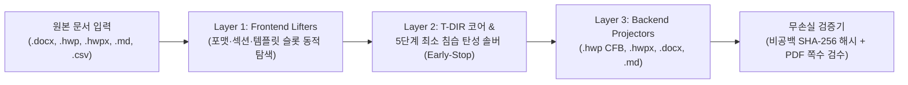

# T-DIR (`document-IR`) — 위상 보존 문서 중간 표현(Topological Document IR) 기반 MCP 서버

🌐 **[English (./README.md)](./README.md)** | 🇰🇷 **[한국어 (./README_KO.md)](./README_KO.md)**

> [!WARNING]
> **개발 진행 중 안내 (Work in Progress / Experimental Beta — `v3.0.0-beta`)**
> 본 레포지토리는 현재 활발히 개발 및 아키텍처 검증이 진행 중인 **실험적 베타(Beta) 버전**으로, **아직 모든 기능이 완성된 상태가 아닙니다.**
> - 단독 `.hwpx` 컨테이너 내부의 `<hp:pic>` 바이너리 이미지 스트림 직접 주입, `.xlsx` 스프레드시트 셀 스타일 리프팅, 수식 AST(`LaTeX` $\leftrightarrow$ `HWP EQN` $\leftrightarrow$ `OMML`) 양방향 컴파일러 등 일부 기능은 현재 구현 및 고도화 진행 중입니다.
> - 베타 회귀 검증 과정에서 내부 IR 스키마(`SectionIR`, `SlotSpecIR`, `TargetDocumentSpecIR`, `ElasticLayoutState`) 및 MCP 툴 인터페이스가 예고 없이 변경될 수 있습니다.

---

## 1. 프로젝트 개요 및 배경 (Overview & Motivation)

**T-DIR (Topological Document Intermediate Representation)**은 한국 공공기관·기업 표준 문서 포맷(**한글 HWP v5.0 바이너리 `.hwp`**, **개방형 한글 `.hwpx`**)과 글로벌 문서 포맷(**MS Word `.docx`**, **Markdown `.md`**, **CSV/TSV `.csv`/`.tsv`**) 간의 구조적·기하학적 이질성을 해결하기 위해 설계된 문서 중간 표현(IR) 엔진이자 **MCP (Model Context Protocol) 서버**입니다.

### 기존 1:1 문서 변환 방식의 한계점
1. **박스 모델(Box-Sizing) 및 물리 좌표계 불일치**: `HWPUNIT`($1\text{ pt} = 100\text{ HU}$), `Twips`($1\text{ pt} = 20\text{ dxa}$), 픽셀 단위를 단순 1:1 치환할 경우 중첩 표의 셀 여백, 셀 병합(`gridSpan` / `vMerge`), 장식용 빈 스페이서 열에서 오차가 누적되어 표가 깨지거나 문단 폭이 어긋납니다.
2. **문서 그리드 스냅(`snapToGrid`)에 의한 줄간격 팽창**: `맑은 고딕`(`usWinAscent=1456, usWinDescent=398`) 등 상하 메트릭이 큰 한글 폰트를 MS Word/한글의 기본 줄 그리드 스냅(`w:lineRule="auto"`) 상태로 두면 12pt 본문 1줄이 약 $22.2\text{ pt}$($440\text{ twips}$)로 팽창하여 고정 양식 페이지 밖으로 넘치는 하단 잘림 현상이 발생합니다.
3. **고정 양식 템플릿(`2x2` 본문 표 및 `6x2` 첨부 표) 파손**: 정부지원사업 사업계획서 등 한국형 양식 문서는 각 문항(`Q1`, `Q2`, `Q3`, `Q4`)이 외곽 `2x2` 고정 표 내부에 들어가고 이미지가 최하단 `붙임` `6x2` 규격 표에 순서대로 배치되어야 합니다. 단순 복사·붙여넣기 시 외곽 표가 임의로 쪼개지거나 쪽마다 헤더가 반복 출력되는 문제가 발생합니다.
4. **에이전트(LLM) 추론 시간 및 토큰 비용 과다**: 수만 줄에 달하는 OOXML(`word/document`)이나 OWPML(`Contents/section0`) XML 원문을 LLM 컨텍스트에 직접 올리면 $O(N^2)$ 어텐션 비용이 급증하고 텍스트 누락(환각) 위험이 커집니다.

---

## 2. 핵심 아키텍처 (3-계층 위상 파이프라인)

T-DIR은 **텍스트 원문 불변성(Content Immutability)**, **2차원 표 위상 정규화(2D Grid Topology)**, **물리 엔진 투영(Metric Projection)**을 3개의 독립 계층으로 분리합니다.



### Layer 1: 동적 리프터(Lifters) 및 템플릿 슬롯 자동 스캐너
- **하드코딩 없는 동적 슬롯 탐색**: HWP v5.0 템플릿의 압축된 `Section0` 바이너리 레코드 트리(`Tag 71`, `Tag 77`, `Tag 72`)를 런타임에 스캔하여 `2x2` 문항 본문 슬롯(`Q1`..`Q4`)과 최하단 `6x2` 사진 첨부 슬롯(`ATTACH 1..6`)의 레코드 위치와 가용 폭을 자동 역산합니다.
- **2차원 표 위상 정규화**: 가로·세로 병합을 2D 행렬로 복원한 뒤 텍스트가 없는 장식용 빈 스페이서 행/열을 제거하고, 화살표 기호(`▶`, `→`) 열 폭 클램핑 및 계단식 막대 차트 표의 시간순(`C0..C3`) 정규화를 수행합니다.

### Layer 2: 5단계 최소 침습 탄성 레이아웃 솔버 (`MinimumInvasionElasticSolver` Early-Stop)
원본 텍스트를 단 1글자도 삭제·요약하지 않으면서 목표 쪽수 예산(예: `Q1` 2쪽 + `Q2` 2쪽 = 총 4쪽) 안에 맞추기 위해, 문단 꾸겨넣기(과잉 병합)를 최소화하는 **5단계 점진적 조기 종료(Early-Stop)** 알고리즘을 적용합니다:
- **Stage 1 (빈 스페이서 제거)**: 빈 스페이서 문단과 표 내부 빈 스페이서 행/열만 제거하고 그리드 스냅(`snapToGrid`)을 해제합니다.
- **Stage 2 (줄간격 및 셀 패딩 탄성 압축)**: 원본 문단 줄바꿈을 **100% 그대로 보존**한 상태에서 본문 줄간격(`160% -> 122%`), 표 줄간격(`130% -> 112%`), 셀 상하 패딩(`100 HU -> 35 HU`)만 점진적으로 압축합니다.
- **Stage 3 (단독 짧은 소제목 인라인화 조기 종료)**: 단독 1줄짜리 짧은 소제목($\le 40$자, 마침표 미포함)만 뒤따르는 본문 문단 앞머리에 굵은 글씨(`Bold`) 인라인 리드로 결합합니다(이때 비공백 문자 해시가 변하지 않도록 공백 2칸 `"  "`만 구분자로 사용). 목표 높이 이하로 들어오면 **즉시 종료(Early-Stop)**하여 표 내부 셀 줄바꿈과 본문 문단을 100% 보존합니다.
- **Stage 4 (표 내부 셀 최단 문단 쌍 부분 병합 조기 종료)**: 여전히 예산을 초과할 경우에만, 다중 문단을 가진 표 셀 중 합산 길이가 가장 짧은 인접 문단 쌍부터 **1쌍씩만 순차 병합**하며 매 스텝 예산 달성 시 즉시 멈춥니다.
- **Stage 5 (본문 연속 문단 최소 병합 조기 종료)**: Stage 4 이후에도 미세하게 예산을 초과하는 경우에만 가장 짧은 본문 연속 문단 쌍을 1쌍씩 병합하고 예산 충족 즉시 멈춥니다.

### Layer 3: 결정론적 바이너리·XML 프로젝터 및 무손실 검증기
- **HWP v5.0 네이티브 바이너리 프로젝터 ([`./codec_hwp_v5.py`](./codec_hwp_v5.py) + [`./cfb_ole2.py`](./cfb_ole2.py))**: 외부 한글 프로그램 없이 순수 파이썬으로 HWP v5.0 바이너리 레코드와 MS-CFB(`CFBArchive` OLE2 512B 섹터 / 64B 미니스트림 / Red-Black 디렉토리 트리) 컨테이너를 재조립합니다.
- **100.00% 비공백 텍스트 불변성 검증 ([`./ir_schema.py`](./ir_schema.py))**: 변환 전·후 모든 섹션의 비공백 문자 시퀀스(`SHA-256`)를 대조하여 단 1글자의 유실이나 변조(`0`자 손실)도 없음을 수학적으로 보증합니다.

---

## 3. 레포지토리 파일 구성

| 모듈 경로 | 역할 및 설명 |
| :--- | :--- |
| [`./__init__.py`](./__init__.py) | 패키지 초기화 및 주요 클래스(`TdirBetaMcpServer`, `MinimumInvasionElasticSolver`) 익스포트 |
| [`./ir_schema.py`](./ir_schema.py) | T-DIR v3.0 핵심 데이터클래스(`TextRunIR`, `ParagraphIR`, `TableCellIR`, `TableGridIR`, `MediaObjectIR`, `SectionIR`, `SlotSpecIR`, `TargetDocumentSpecIR`, `ConversionJobIR`) 및 비공백 `SHA-256` 무손실 검증기 |
| [`./cfb_ole2.py`](./cfb_ole2.py) | 순수 파이썬 MS-CFB (`CFBArchive` OLE2 Compound File Binary v3) 파서 및 빌더 (512B 섹터, 64B 미니스트림, Red-Black 트리 직렬화) |
| [`./elastic_solver.py`](./elastic_solver.py) | 2D 표 위상 정규화기 및 5단계 최소 침습 조기 종료 솔버(`MinimumInvasionElasticSolver`, `ElasticLayoutState`) |
| [`./codec_hwp_v5.py`](./codec_hwp_v5.py) | HWP v5.0 바이너리 레코드 파서, 동적 템플릿 슬롯 스캐너, 리프터 및 프로젝터 |
| [`./codec_ooxml_owpml.py`](./codec_ooxml_owpml.py) | OOXML(`.docx`) 및 OWPML(`.hwpx`) 동적 섹션 리프터 및 프로젝터 |
| [`./codec_tabular_markup.py`](./codec_tabular_markup.py) | Markdown(`.md`) 및 정형 표(`.csv`, `.tsv`) 리프터·프로젝터 |
| [`./mcp_server.py`](./mcp_server.py) | JSON-RPC 2.0 (`stdio`) 기반 독립 MCP 서버 (`TdirBetaMcpServer` / `tdir-document-beta`, 5대 툴 제공) |
| [`./test_regression_suite.py`](./test_regression_suite.py) | PoC 1·2·3 통합 회귀 검증 스위트 (동적 탐색 $\to$ Early-Stop 솔빙 $\to$ 다중 포맷 사출 $\to$ `SHA-256` 및 PDF 8쪽 검수) |

---

## 4. 제공되는 5대 MCP 툴 명세

```python
# 1. 원본 문서 및 타겟 템플릿 슬롯 동적 프로빙
tdir_probe_files(source_paths: list[str], target_path: str) -> dict

# 2. 섹션·미디어 슬롯 매핑 플랜 수립 및 탄성 솔버 Early-Stop 단계 프리뷰
tdir_build_mapping_plan(job_id: str, user_constraints: dict | None = None) -> dict

# 3. 다중 포맷(["hwp", "hwpx", "docx", "md"]) 위상 보존 변환 실행
tdir_execute_conversion(job_id: str, output_prefix: str, output_formats: list[str], base_hwpx_path: str | None = None) -> dict

# 4. 비공백 SHA-256 100.00% 텍스트 무손실 검증 및 헤드리스 PDF 쪽수 검수
tdir_verify_fidelity_and_layout(job_id: str, export_pdf: bool = True) -> dict

# 5. 특정 문단 병합 잠금 및 표 열 폭 핀포인트 미세 조정
tdir_adjust_block_layout(job_id: str, section_uid: str, block_index: int, lock_unmerged: bool | None = None, col_widths_hu: list[int] | None = None) -> dict
```

1. **Tool 1 — 원본 및 템플릿 동적 프로빙**: 원본 문서의 포맷과 섹션 구조(글자 수, 표 개수, 문단 수, 미디어 개수, `SHA-256`) 및 타겟 템플릿의 슬롯(`2x2` 본문 슬롯, `6x2` 첨부 슬롯)을 런타임에 동적 탐색하여 요약 메타데이터만 반환합니다.
2. **Tool 2 — 매핑 플랜 수립 및 탄성 솔버 프리뷰**: 원본 섹션·이미지를 타겟 템플릿 슬롯에 매핑하고, `MinimumInvasionElasticSolver` 시뮬레이션을 통해 각 섹션이 몇 단계(`Stage 1`~`Stage 5`)에서 조기 종료되는지와 보존되는 문단 수를 프리뷰합니다.
3. **Tool 3 — 다중 포맷 변환 실행**: 지정된 출력 포맷(`["hwp", "hwpx", "docx", "md"]`)으로 위상 보존 변환 파일을 일괄 생성합니다.
4. **Tool 4 — 무손실 텍스트 및 레이아웃 쪽수 검증**: 생성된 파일들을 역파싱하여 원본 대비 비공백 텍스트 100.00% 포함 여부(`0`자 손실)를 검증하고, 선택적으로 헤드리스 PDF 렌더링을 수행해 목표 쪽수(예: 8쪽) 준수 여부를 확인합니다.
5. **Tool 5 — 블록 단위 핀포인트 레이아웃 미세 조정**: 특정 문단의 병합 잠금이나 특정 표의 열 폭을 핀포인트로 미세 조정합니다.

---

## 5. 실행 및 MCP 서버 등록 방법

### 요구 사항
- Python 3.10 이상 (코어 `.hwp`, `.hwpx`, `.docx`, `.md`, `.csv` 변환에는 외부 서드파티 패키지 설치 없이 파이썬 표준 라이브러리 `zlib`, `struct`, `zipfile`, `hashlib`만 사용합니다).
- 선택 사항: Tool 4에서 헤드리스 PDF 렌더링으로 실제 쪽수를 검수할 경우 Windows 환경의 MS Word가 사용됩니다.

### MCP 클라이언트 설정
```json
{
  "mcpServers": {
    "tdir-document-beta": {
      "command": "python",
      "args": ["mcp_server.py"],
      "cwd": "/path/to/-document-IR"
    }
  }
}
```

---

## 6. 현재 베타 버전의 한계점 및 향후 로드맵 (WIP Notice)

본 프로젝트는 현재 **개발 중인 초기 베타(`v3.0.0-beta`)** 상태이므로 다음 항목들이 순차적으로 보완될 예정입니다:
1. **단독 `.hwpx` 출력 시 바이너리 이미지 직접 바인딩**: 현재 `.hwp`(HWP v5.0 바이너리)와 `.docx` 출력에서는 `6x2` 첨부 표 내부에 이미지 바이너리 스트림(`BinData/BIN0001` 및 `word/media/image1`)과 캡션이 100% 삽입되며, `.hwpx` 단독 출력에서는 캡션 텍스트까지 반영되고 `<hp:pic>` 및 `BinData/` ZIP 엔트리 직접 주입 기능은 추가 구현 중입니다.
2. **임의 양식 템플릿 일반화**: 현재 동적 슬롯 스캐너는 정부지원사업 표준 양식 구조(`2x2` 섹션 외곽 표 + `6x2` 사진 첨부 표)를 우선 지원하며, 향후 임의의 $N \times M$ 복합 양식 표로 일반화할 예정입니다.
3. **수식 AST 양방향 컴파일러 (`OMML` $\leftrightarrow$ `HWP EQN` $\leftrightarrow$ `LaTeX`)**: 현재 수식 노드는 텍스트 런으로 보존되며, `v3.1`에서 수식 스크립트 AST 변환기가 추가될 예정입니다.
4. **네이티브 `.xlsx` 및 `.html` 프로젝터 확장**: 현재 `.csv`/`.tsv` 및 `.md` 코덱이 구현되어 있으며, 셀 서식이 포함된 `.xlsx` 및 `.html` 프로젝터가 추가될 예정입니다.
