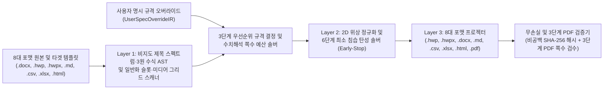

# T-DIR (`document-IR`) — 위상 보존 문서 중간 표현(Topological Document IR) 기반 MCP 서버

**[last patch : 2026-11-09 02:25:00 UTC]**

🌐 **[English (./README.md)](./README.md)** | 🇰🇷 **[한국어 (./README_KO.md)](./README_KO.md)**

> [!NOTE]
> **프로덕션 하드닝 릴리스 (`v4.0.0`) — 지속적 엔지니어링 안내**
> 본 레포지토리는 8대 문서 포맷(`.hwp`, `.hwpx`, `.docx`, `.md`, `.csv`, `.xlsx`, `.html`, `.pdf`) 양방향 변환, 단독 `.hwpx` 패키지 합성 및 `<hp:pic>` 바이너리 이미지 직접 주입(`[P2-01]`), 3원 동형 수식 AST 컴파일러(`OMML` $\leftrightarrow$ `HWP EQN` $\leftrightarrow$ `LaTeX`, `[P2-02]`), 3단계 크로스 플랫폼 PDF 검증기(`[P3-02]`), 그리고 6대 보안·멱등성 하드닝(`[SEC-01]` ~ `[SEC-06]`)이 완비된 `v4.0.0` 아키텍처를 구현하고 있습니다. 13대 파라메트릭 회귀 실험 매트릭스(`EXP-01` ~ `EXP-13`) 전 항목을 100.00% `SHA-256` 무결성 및 미결사항 0건으로 통과하였으며, 외부 기관의 신규 비정형 양식 변종에 대한 확장은 지속적으로 수행됩니다.

---

## 1. 프로젝트 개요 및 배경 (Overview & Motivation)

**T-DIR (Topological Document Intermediate Representation)**은 한국 공공기관·기업 표준 문서 포맷(**한글 HWP v5.0 바이너리 `.hwp`**, **개방형 한글 `.hwpx`**)과 글로벌 문서 포맷(**MS Word `.docx`**, **OpenXML 스프레드시트 `.xlsx`**, **시맨틱 웹 문서 `.html`**, **PDF 1.4 `.pdf`**, **Markdown `.md`**, **CSV/TSV `.csv`/`.tsv`**) 간의 구조적·수식적·기하학적 이질성을 해결하기 위해 설계된 문서 중간 표현(IR) 엔진이자 **MCP (Model Context Protocol) 서버**입니다.

### 기존 1:1 문서 변환 방식의 한계점
1. **박스 모델(Box-Sizing) 및 물리 좌표계 불일치**: `HWPUNIT`($1\text{ pt} = 100\text{ HU}$), `Twips`($1\text{ pt} = 20\text{ dxa}$), `EMU`($1\text{ HU} = 127\text{ EMU}$), 픽셀 단위를 단순 1:1 치환할 경우 중첩 표의 셀 여백, 셀 병합(`gridSpan` / `vMerge`), 장식용 빈 스페이서 열에서 오차가 누적되어 표가 깨지거나 문단 폭이 어긋납니다.
2. **문서 그리드 스냅(`snapToGrid`)에 의한 줄간격 팽창**: 상하 메트릭이 큰 한글 폰트를 MS Word/한글의 기본 줄 그리드 스냅(`w:lineRule="auto"`) 상태로 두면 본문 1줄 높이가 과도하게 팽창하여 고정 양식 페이지 밖으로 넘치는 하단 잘림 현상이 발생합니다.
3. **고정 양식 템플릿(`SLOT 01..M` 본문 표 및 `2R x C` 첨부 표) 파손**: 공공·기업 양식 문서는 각 섹션이 외곽 고정 표 내부에 들어가고 이미지가 하단 `2R x C` 주기적 그리드 슬롯(`MEDIA 01..P`)에 배치되어야 합니다. 단순 복사·붙여넣기 시 외곽 표가 임의로 쪼개지거나 쪽마다 헤더가 반복 출력되는 문제가 발생합니다.
4. **에이전트(LLM) 추론 시간 및 토큰 비용 과다**: 수만 줄에 달하는 OOXML(`word/document`)이나 OWPML(`Contents/section0`) XML 원문을 LLM 컨텍스트에 직접 올리면 $O(N^2)$ 어텐션 비용이 급증하고 텍스트 누락(환각) 위험이 커집니다.

---

## 2. 핵심 아키텍처 및 무(無)하드코딩 수치해석·위상 결정 파이프라인 (`v4.0.0`)

T-DIR은 특정 폰트명, 픽셀/HWPUNIT 상수, 특정 섹션 ID(`Q1..Q4`), 특정 쪽수(`8쪽` / 섹션당 `2쪽`), 특정 문서 고유 문자열을 코드에 하드코딩하지 않고, **비지도 제목 스펙트럼 분석**, **3원 동형 수식 AST 컴파일**, **일반화된 템플릿 슬롯 위상 탐색**, **수치해석 기반 쪽수 예산 솔버**, 그리고 **사용자 MCP 명시 규격(`UserSpecOverrideIR`) 우선순위 결합**으로 작동합니다.



### 2.1. 3단계 규격 우선순위 결정 체계
모든 타이포그래피(폰트 패밀리, 본문/표 글자 크기, 줄간격 범위)와 기하 규격(용지 크기, 여백, 슬롯 폭/높이, 쪽수 예산)은 [`./ir_schema.py`](./ir_schema.py)의 우선순위 체인에 의해 결정론적으로 결합됩니다:

$$\text{EffectiveSpec} = \text{Priority 1 }(\text{UserSpecOverrideIR}) \succ \text{Priority 2 }(\text{TargetDocumentSpecIR}) \succ \text{Priority 3 }(\text{SourceDocumentSpecIR})$$

1. **Priority 1 — 사용자 명시 규격 (`UserSpecOverrideIR`)**: 사용자 또는 에이전트가 MCP 호출 시 명시한 본문/표 폰트 패밀리, 글자 크기(pt), 줄간격 상·하한 퍼센트, 용지 규격 및 여백(mm), 총 쪽수 상한, 섹션별 쪽수 예산, 외곽 표 보존 여부, 미세 폰트 탄성 스케일링 허용 여부, 첨부 캡션 목록이 최우선 적용됩니다.
2. **Priority 2 — 타겟 템플릿 동적 추출 규격 (`TargetDocumentSpecIR` / [`./codec_hwp_v5.py`](./codec_hwp_v5.py))**: 타겟 HWP 템플릿 바이너리 스트림을 런타임에 파싱하여 추출합니다:
   - `DocInfo` 스트림: `Tag 19`(UTF-16LE 폰트명 목록), `Tag 21`(글자 크기 `HU` 및 RGB 색상), `Tag 25`(문단 줄간격 퍼센트).
   - `Section0..SectionN` 스트림: `Tag 73`(용지 폭·높이·여백 `HU`), 표지/프리앰블 블록, 일반화된 `NxM` 섹션 외곽 표(`SLOT 01..M` 및 서수 인덱스), 하단 `2R x C` 주기적 교번 미디어 슬롯(`MEDIA 01..P`).
3. **Priority 3 — 원본 문서 동적 추출 규격 (`SourceDocumentSpecIR` / [`./codec_ooxml_owpml.py`](./codec_ooxml_owpml.py))**: 원본 문서(`.docx`, `.hwpx`, `.hwp`)에서 추출한 본문/표 대표 폰트 및 글자 크기로, 타겟 템플릿의 본문 셀이 비어 있을 때 자동 승계됩니다.

### 2.2. 비지도 제목 스펙트럼 및 일반화 슬롯·미디어 위상 스캐너 (`[NUM-01]` ~ `[NUM-03]`)
- **비지도 대단원 제목 스펙트럼 탐지기 (`[NUM-01]`)**: 본문 문단들의 최빈 글자 크기 $S_{\text{mode}}$를 통계적으로 산출하고, OOXML 개요 수준(`outlineLvl == 0` / `Heading1`), 구조적 장·절 접두사(`제1장`, `I.`, `Ⅰ.`, `Chapter 1`, `Q1.`), 또는 글자 크기 점프($\ge S_{\text{mode}} + 150\text{ HU}$ 굵은 글씨)를 통해 하드코딩 문자열 없이 일반화된 섹션(`SectionIR`)을 추출합니다.
- **위상 기반 서수 접두 안내문 필터 (`[NUM-01]`)**: 첫 번째 서수(`1`) 본문 슬롯 표 이전에 등장하는 비서수 안내 박스를 위상적으로 판별하여 `"작성 요령"` 같은 문자열 하드코딩 없이 자동 분리합니다.
- **범용 섹션·슬롯 셀렉터 매처 (`[NUM-02]`)**: `UserSpecOverrideIR`의 셀렉터가 일반 섹션 ID(`SEC 01`), 타겟 슬롯 ID(`SLOT 01`), 서수 인덱스(`1`, `"2"`), 제목 부분 문자열(`"Q1"`, `"제1장"`)을 모두 수용하며, 특정 문서 전용 기본 제외 목록을 완전히 제거하였습니다.
- **일반화된 $2R \times C$ 주기적 미디어 그리드 탐지기 (`[NUM-03]`)**: 짝수 행($2R \times C$, $R \ge 1, 1 \le C \le 4$) 표에서 이미지 행($H_{2r} \ge 3000\text{ HU}$)과 캡션 행($H_{2r} \ge 2 \cdot H_{2r+1}$)의 교번 높이 비율 불변식을 검증하여 `MEDIA 01..P` (`SlotSpecIR`) 슬롯을 동적 생성합니다.

### 2.3. 수치해석 기반 쪽수 예산 배분 솔버 및 6단계 탄성 솔버 (`[NUM-04]`)
- **물리적 박스 모델 페이지 수용 높이**: 경험적 매직 상수 대신 결정된 `TargetDocumentSpecIR` 용지 기하 규격(표준 A4 기준 $84,188\text{ HU} - 2,800\text{ HU} - 2,800\text{ HU} = 78,588\text{ HU}$)으로부터 유효 본문 높이를 직접 계산합니다.
- **자율 쪽수 예산 배분 솔버 ([`./elastic_solver.py`](./elastic_solver.py))**: 전체 쪽수 상한, 섹션별 명시 예산, 또는 Stage-2 자연 본문 높이에 기반하여 각 섹션의 목표 쪽수 $B_k$와 전체 예상 쪽수($P_{\text{expected}} = P_{\text{preamble}} + P_{\text{body}} + P_{\text{unmapped}} + P_{\text{media}}$)를 최대 잔여법(Largest-Remainder Method)으로 수치해석적으로 산출합니다.
- **6단계 최소 침습 탄성 레이아웃 솔버 (`MinimumInvasionElasticSolver`)**: 목표 예산 $B_k$ 이하로 들어오는 순간 **즉시 멈추는(Early-Stop)** 6단계 루프(**Stage 1** 스페이서 소거 $\to$ **Stage 2** 줄간격 보간 $\to$ **Stage 3** 단독 소제목 인라인 결합 $\to$ **Stage 4** 표 셀 내부 최소 길이 문단 쌍 병합 $\to$ **Stage 5** 본문 연속 문단 최소 병합 $\to$ **Stage 6** 선택적 미세 폰트 스케일링)를 수행합니다.

### 2.4. `v4.0.0` 핵심 고도화 및 보안 하드닝 완결 내역 (`[P2-01]` ~ `[P3-02]`, `[SEC-01]` ~ `[SEC-06]`)
1. **단독 OWPML(`.hwpx`) 패키지 합성 및 양방향 리프팅 (`[P2-01]`)**: 외부 참조 `.hwpx` 파일이 전혀 없는 상태에서도 OWPML 표준 아카이브(`mimetype`, `META-INF/container`, `Contents/content`, `Contents/header`, `Contents/section0`)를 독립 생성하고, `<hp:pic>` + `<hc:img>` + `Contents/BinData/` 바이너리 이미지를 직접 주입하며, `.hwpx` 원본 문서를 다시 `SectionIR`로 리프팅합니다.
2. **3원 동형(3-Way Isomorphic) 수식 AST 양방향 컴파일러 (`[P2-02]`)**: **MS Word OMML**(`<m:oMath>`), **한컴 수식 스크립트**(`.hwp` 바이너리 `Tag 105` 및 `.hwpx` `<hp:equation>`), **LaTeX**(`.md` `$...$`/`$$...$$` 및 `.html` `<math data-latex="...">`) 간에 정규화된 수식 AST(`frac`, `sqrt`, `sup`, `sub`, `subsup`, `bigop`, `delim`, `matrix`, `sym`, `text`, `seq`)를 통해 수식을 무손실 상호 번역합니다.
3. **양방향 OpenXML 스프레드시트(`.xlsx`) 및 시맨틱 HTML5 DOM(`.html`) 코덱 (`[P3-01]`)**: 공유 문자열 테이블(`xl/sharedStrings`), 셀 스타일(`xl/styles`), 병합 셀 범위(`<mergeCells>` 및 HTML `rowspan`/`colspan`), base64 인코딩 미디어의 양방향 리프팅 및 프로젝션을 지원합니다.
4. **결정론적 순수 파이썬 PDF 1.4 프로젝터 및 3단계 크로스 플랫폼 검증기 (`[P3-02]`)**: 외부 프로그램 없이도 순수 파이썬으로 Type0/CIDFontType2 UTF-16BE(`<FEFF...>`) 한글 스트림이 탑재된 다중 페이지 PDF 1.4 문서를 직접 생성하며, 3단계 검증 엔진(**Tier 1**: Windows MS Word COM $\to$ **Tier 2**: Headless LibreOffice $\to$ **Tier 3**: 내장 결정론적 PDF 1.4 렌더러 및 UTF-16BE 검증기)으로 모든 운영체제에서 쪽수 예산과 텍스트 무결성을 검증합니다.
5. **보안 및 사이드이펙트 6대 하드닝 (`[SEC-01]` ~ `[SEC-06]`)**:
   - `[SEC-01]` XML `DOCTYPE` / `ENTITY`(XXE 및 Billion Laughs 폭탄) 원천 차단 및 XML 바이트 상한(`64 MB`) 강제.
   - `[SEC-02]` ZIP 경로 이탈(`Zip-Slip` `../`) 및 압축 폭탄 차단, `.hwp` 스트림 `zlib` 청크 단위 상한(`64 MB`) 해제.
   - `[SEC-03]` MS-CFB 헤더 매직 검증, 디렉토리 엔트리 상한(`8,192`개), 스트림 크기 상한(`128 MB`), `DIFAT`/`FAT`/`MiniFAT` 체인 순환(`visited` 집합) 무한 루프 방어(`CFBArchive`).
   - `[SEC-04]` 파일시스템 경로 정규화, Null 바이트(`\x00`) 차단 및 Windows 예약 디바이스명(`CON`, `PRN`, `AUX`, `NUL`, `COM1..9`, `LPT1..9`) 차단.
   - `[SEC-05]` XML 1.0 비허용 제어문자(`U+0000..U+001F`, 탭·개행 제외) 자동 제거 및 스프레드시트 DDE/수식 인젝션(`=`, `+`, `-`, `@` 접두사) 무력화.
   - `[SEC-06]` 탄성 솔버(`MinimumInvasionElasticSolver`) 구동 전 블록 깊은 복사(Deep-Copy) 격리를 통한 동일 Job 반복 실행 멱등성 100% 보장 및 64개 Job LRU 캐시 상한(`TdirBetaMcpServer`) 적용.

---

## 3. 레포지토리 파일 구성

| 모듈 경로 | 역할 및 설명 |
| :--- | :--- |
| [`./__init__.py`](./__init__.py) | 패키지 초기화(`v4.0.0`) 및 주요 클래스(`TdirBetaMcpServer`, `MinimumInvasionElasticSolver`, `SourceDocumentSpecIR`, `TargetDocumentSpecIR`, `UserSpecOverrideIR`) 익스포트 |
| [`./ir_schema.py`](./ir_schema.py) | T-DIR v4.0 데이터클래스(`TextRunIR`, `ParagraphIR`, `TableCellIR`, `TableGridIR`, `MediaObjectIR`, `SectionIR`, `SlotSpecIR`, `SourceDocumentSpecIR`, `TargetDocumentSpecIR`, `UserSpecOverrideIR`, `ConversionJobIR`), 3원 동형 수식 AST 컴파일러, 보안 검증기(`[SEC-01]`..`[SEC-05]`), 비지도 제목 스펙트럼 탐지기 및 비공백 `SHA-256` 검증기 |
| [`./cfb_ole2.py`](./cfb_ole2.py) | 순수 파이썬 MS-CFB (`CFBArchive` OLE2 Compound File Binary v3) 파서 및 빌더 (512B 섹터, 64B 미니스트림, `DIFAT`/`FAT`/`MiniFAT` 순환 방어 `[SEC-03]`, 고정소수점 FAT 할당, `BinData` 스토리지 자동 생성, Red-Black 트리 직렬화) |
| [`./elastic_solver.py`](./elastic_solver.py) | 순수 위상 기반 2D 표 정규화기, 수치해석 쪽수 예산 배분기 및 6단계 최소 침습 조기 종료 솔버(`MinimumInvasionElasticSolver`, `ElasticLayoutState`) |
| [`./codec_hwp_v5.py`](./codec_hwp_v5.py) | HWP v5.0 바이너리 레코드 파서(상한 스트리밍 압축 해제 `[SEC-02]` 및 다중 섹션 `Section0..SectionN` 지원), `DocInfo` 동적 타이포그래피 추출기, `Tag 105` 수식 레코드 빌더/파서(`[P2-02]`), UTF-16LE 서로게이트 페어 안전 `WCHAR` 계산기, 일반화 `SLOT 01..M` 및 `2R x C` `MEDIA 01..P` 스캐너, 리프터 및 바이너리 프로젝터 |
| [`./codec_ooxml_owpml.py`](./codec_ooxml_owpml.py) | OOXML(`.docx`) 및 OWPML(`.hwpx`) 스타일·용지 스캐너, 비지도 제목 스펙트럼 리프터, `<m:oMath>` OMML 및 `<hp:equation>` 수식 리프터/프로젝터, 단독 `.docx` 및 단독 `.hwpx` 패키지 합성기(`[P2-01]`), `<hp:pic>` 바이너리 이미지 주입기 및 `TargetDocumentSpecIR` 기반 프로젝터 |
| [`./codec_tabular_markup.py`](./codec_tabular_markup.py) | Markdown(`.md` LaTeX 수식 포함), 정형 표(`.csv`, `.tsv`), OpenXML 스프레드시트(`.xlsx` `<mergeCells>` 및 DDE 방어 포함), 시맨틱 HTML5 DOM(`.html` `<math data-latex="...">` 및 base64 미디어 포함), 결정론적 순수 파이썬 PDF 1.4(`.pdf`) 양방향 리프터·프로젝터 |
| [`./mcp_server.py`](./mcp_server.py) | JSON-RPC 2.0 (`stdio`) 기반 독립 MCP 서버 (`TdirBetaMcpServer` / `tdir-document-beta` `v4.0.0`, 5대 툴, 8대 포맷 변환, 3단계 크로스 플랫폼 PDF 검증, 깊은 복사 멱등성 보장 및 64개 Job LRU 캐시 관리 `[SEC-06]`) |
| [`./test_regression_suite.py`](./test_regression_suite.py) | **13대 파라메트릭 회귀 실험 매트릭스(`EXP-01` ~ `EXP-13`)** 통합 검증 스위트 (다중 문서 계층, 쪽수 예산 스윕, 용지·폰트 메트릭 공간, 2D 표 위상 스트레스, 일반화 템플릿 위상, 교차 포맷 왕복, 유니코드·DIFAT 스트레스, 다중 소스 에이전트 루프, 단독 `.hwpx` 합성, 3원 수식 AST, `.xlsx`/`.html` 양방향 코덱, 순수 파이썬 `.pdf` 3단계 검증, `[SEC-01]`..`[SEC-06]` 보안·멱등성 검증) |

---

## 4. 제공되는 5대 MCP 툴 및 `UserSpecOverrideIR` 스키마 명세

```python
# 1. 원본 문서(.docx, .hwp, .hwpx, .md, .csv, .tsv, .xlsx, .html) 및 타겟 템플릿 동적 프로빙
tdir_probe_files(source_paths: list[str], target_path: str) -> dict

# 2. 3단계 우선순위 규격 결정, 수치해석 쪽수 예산 산출 및 6단계 탄성 솔버 프리뷰
tdir_build_mapping_plan(
    job_id: str,
    user_spec_overrides: dict | None = None,
    user_constraints: dict | None = None,
) -> dict

# 3. 8대 포맷(["hwp", "hwpx", "docx", "md", "csv", "xlsx", "html", "pdf"]) 위상 보존 변환 실행
tdir_execute_conversion(
    job_id: str,
    output_prefix: str,
    output_formats: list[str] | None = None,
    page_body_height_hu: int | None = None,
    base_hwpx_path: str | None = None,
    user_spec_overrides: dict | None = None,
) -> dict

# 4. 비공백 SHA-256 100.00% 텍스트 무손실 검증 및 3단계 크로스 플랫폼 PDF 쪽수 예산 검수
tdir_verify_fidelity_and_layout(job_id: str, export_pdf: bool = True) -> dict

# 5. 특정 문단 병합 잠금 및 표 열 폭 핀포인트 미세 조정 (즉시 솔버 프리뷰 갱신 포함)
tdir_adjust_block_layout(
    job_id: str,
    section_uid: str,
    block_index: int,
    lock_unmerged: bool | None = None,
    col_widths_hu: list[int] | None = None,
) -> dict
```

### `UserSpecOverrideIR` 지원 파라미터 예시
사용자나 에이전트는 Tool 2 또는 Tool 3 호출 시 아래 필드를 통해 타이포그래피, 기하 규격, 또는 수치해석 쪽수 예산을 명시적으로 지정할 수 있습니다:

```json
{
  "body_font_family": "함초롬바탕",
  "table_font_family": "함초롬돋움",
  "body_font_size_pt": 11.5,
  "table_font_size_pt": 9.5,
  "body_line_spacing_min_pct": 122,
  "body_line_spacing_max_pct": 160,
  "table_line_spacing_min_pct": 112,
  "table_line_spacing_max_pct": 125,
  "page_width_mm": 210.0,
  "page_height_mm": 297.0,
  "margins_mm": {"top": 15.0, "bottom": 15.0, "left": 20.0, "right": 20.0},
  "total_page_limit": 8,
  "section_page_budgets": {"SEC_01": 2.0, "SEC_02": 2.0},
  "exclude_sections": ["SEC_03"],
  "preserve_outer_tables": true,
  "route_media_to_attachment_slots": true,
  "max_attachment_images": 3,
  "attachment_captions": [
    "[붙임 1] 시스템 아키텍처 다이어그램",
    "[붙임 2] 3단계 워크플로우 및 타겟 시장 로드맵"
  ],
  "allow_font_size_elastic_scaling": false,
  "clear_unmapped_slots": false,
  "style_inheritance_mode": "TARGET_FIRST"
}
```

---

## 5. 실행 및 MCP 서버 등록 방법

### 요구 사항
- Python 3.10 이상 (8대 포맷 `.hwp`, `.hwpx`, `.docx`, `.md`, `.csv`, `.xlsx`, `.html`, `.pdf` 전 과정에 외부 서드파티 패키지 설치 없이 파이썬 표준 라이브러리 `zlib`, `struct`, `zipfile`, `hashlib`, `ElementTree`, `HTMLParser`만 사용합니다).
- 선택 사항: Tool 4에서 Tier-1(Windows MS Word COM) 또는 Tier-2(Headless LibreOffice) PDF 검증을 사용할 수 있으며, 외부 프로그램이 없는 환경에서는 Tier-3(내장 결정론적 PDF 1.4 렌더러 및 UTF-16BE 검증기)가 자동으로 작동합니다.

### MCP 클라이언트 설정
```json
{
  "mcpServers": {
    "tdir-document-beta": {
      "command": "python",
      "args": ["mcp_server.py"],
      "cwd": "/path/to/-document-IR"
    }
  }
}
```

---

## 6. `v4.0.0` 13대 파라메트릭 회귀 실험 매트릭스 및 완결 상태

### 6.1. 13대 파라메트릭 회귀 실험 매트릭스 검증 결과 ([`./test_regression_suite.py`](./test_regression_suite.py))
| 코호트 ID | 실험 설계 및 검증 범위 | 실측 판정 |
| :--- | :--- | :--- |
| **`EXP-01`** | **문서 계층 및 비지도 제목 스펙트럼 코호트**: 학술 보고서(`제1장..제3장`), 영문 로마자(`I..III`), 무번호 폰트 크기 점프(`14pt` 대 `10pt`), 실제 사업계획서(`SectionIR`, `SlotSpecIR`) 동적 추출 | `PASS` |
| **`EXP-02`** | **수치해석 쪽수 예산 스윕 및 단조성 코호트**: 여유 예산(`3p` $\to$ 병합 `0`회), 자율 8쪽 상한(`2p` $\to$ 병합 `11`회, 실제 PDF `8`쪽 정확히 일치), 고밀도 예산(`1p` $\to$ 병합 `108`회), 비대칭 분량(`4:1` $\to$ `3p : 1p` 비례 배분) | `PASS` |
| **`EXP-03`** | **용지·타이포그래피 연속 메트릭 코호트**: `A4 가로`(`84,189 x 59,528 HU`, `9pt`) 및 `B5 세로`(`51,591 x 72,850 HU`, `13.5pt`) 연속 스케일링 검증 | `PASS` |
| **`EXP-04`** | **2D 표 위상 스트레스 코호트**: 계단식 희소 차트 압축(`5x4` $\to$ `3x3`), 수직 단계-화살표 폴딩(`3x1` $\to$ `2x1`), `<w:sdt>` 언래핑 및 HWP `Tag 77` 행별 셀 수 불변식 검증 | `PASS` |
| **`EXP-05`** | **일반화 템플릿 위상 코호트**: `4x2`(`4`슬롯) 변형 미디어 그리드 자동 탐지, `BinData` 스토리지 자동 생성 및 비슬롯 일반 문서 모드 검증 | `PASS` |
| **`EXP-06`** | **다대다 교차 포맷 왕복 코호트**: `.docx` $\to$ `.md`(`6,149`자) 및 `.docx` $\to$ `.csv`(`6,462`자) 왕복 리프팅 및 무손실 검증 | `PASS` |
| **`EXP-07`** | **유니코드 서로게이트 페어 및 대용량 `DIFAT` 코호트**: `"A🚀B𝕏\r"`의 HWP `Tag 66`/`Tag 67` `7 WCHAR` 정합성 및 `7,200,000 B` 다중 `DIFAT` 섹터 체인 왕복 무결성 검증 | `PASS` |
| **`EXP-08`** | **다중 이기종 소스 병합 및 에이전트 루프 코호트**: `[.docx, .csv, .md]` 3종 동시 병합(`SlotSpecIR`) 및 Tool 5 (`TdirBetaMcpServer`) 핀포인트 잠금·열 폭 조정 검증 | `PASS` |
| **`EXP-09`** | **단독 OWPML(`.hwpx`) 패키지 합성 및 양방향 리프팅 코호트 (`[P2-01]`)**: 외부 참조 없는 단독 `.hwpx` 생성, `<hp:pic>` 바이너리 이미지 `2`개 주입 및 `.hwpx` $\to$ `.hwp`/`.docx` 왕복(`SHA-256` 100.00% 일치) 검증 | `PASS` |
| **`EXP-10`** | **3원 동형 수식 AST 코호트 (`[P2-02]`)**: Word `OMML`(`<m:oMath>`), 한컴 `HWP EQN`(`Tag 105` 및 `<hp:equation>`), `LaTeX`(`$...$` / `$$...$$`) 간 수식 AST 변환 및 HWP `Tag 105` 레코드 `2`개 검증 | `PASS` |
| **`EXP-11`** | **양방향 OpenXML(`.xlsx`) 및 시맨틱 HTML5 DOM(`.html`) 코호트 (`[P3-01]`)**: `.xlsx`(`106`행, 병합 셀 `7`개, 공유 문자열 `125`개) 및 `.html`(`rowspan`/`colspan` + base64 미디어) 생성·리프팅 왕복 검증 | `PASS` |
| **`EXP-12`** | **결정론적 순수 파이썬 PDF 1.4 및 3단계 검증기 코호트 (`[P3-02]`)**: 순수 파이썬 `8`쪽 PDF 1.4 렌더링 및 UTF-16BE(`<FEFF...>`) 텍스트 스트림 역추출(`6,401`자, 섹션 무결성 100.00% 일치) 검증 | `PASS` |
| **`EXP-13`** | **보안 하드닝 및 다중 실행 멱등성 코호트 (`[SEC-01]` ~ `[SEC-06]`)**: XXE 엔티티 차단, `Zip-Slip` 차단, 바이너리 `MiniFAT` 순환 종료, Null 바이트 경로 차단, DDE 수식 무력화 및 고밀도$\to$여유(`108`회 $\to$ `0`회 병합) 재실행 멱등성 검증 | `PASS` |

### 6.2. 미결사항 해소 상태 (`v4.0.0`)
- **잔여 아키텍처·수치해석·코덱·엣지케이스·보안 미결사항**: **0건 (`P0`, `P1`, `P2`, `P3`, `NUM-01..04`, `SEC-01..06` 전 항목 구현 및 실증 완료).**
